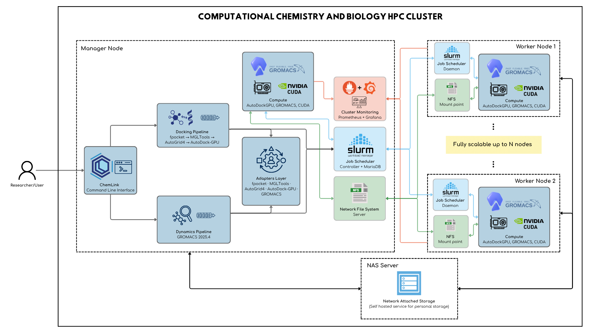

# Instalación y Despliegue — ChemLink

---

## 1. Descripción general de la solución

ChemLink es una plataforma de orquestación científica para flujos de **docking molecular** y **dinámica molecular** en entornos HPC. Opera como capa intermedia entre el investigador y las herramientas de química computacional (AutoDock-GPU, GROMACS, fpocket, Meeko), exponiendo una CLI unificada que abstrae la complejidad de la gestión de clúster, la asignación de GPUs y la coordinación de etapas.

La plataforma puede ejecutarse en tres configuraciones:

| Modo | Descripción |
|---|---|
| **Nodo único local** | CLI directa sobre una estación con GPU, sin SLURM |
| **HPC nativo** | Generación automática de scripts SLURM sobre almacenamiento NFS compartido |
| **Contenedor** | Imagen Docker/Apptainer autocontenida, invocable desde SLURM o localmente |

---

### 1.1 Lenguajes y tecnologías utilizadas

| Capa | Tecnología | Versión |
|---|---|---|
| Lenguaje principal | Python | 3.10 |
| CLI, TUI y salida | Rich, prompt_toolkit, argparse | ≥ 13.0 / ≥ 3.0 |
| Química computacional | RDKit, PDBFixer, OpenBabel | conda-forge |
| Preparación de estructuras | Meeko | conda-forge |
| Preparación de topologías | ACPYPE / AmberTools | conda-forge |
| Detección de sitios activos | fpocket | 4.x |
| Mapas de afinidad | AutoGrid4 | 4.2 |
| Docking molecular | AutoDock-GPU | HEAD (CUDA) |
| Dinámica molecular | GROMACS | 2025.4 |
| Aceleración GPU | NVIDIA CUDA | 12.x |
| Paralelismo MPI | OpenMPI | ≥ 4.1 |
| Gestión de entornos | Miniconda / Conda | latest |
| Gestor de colas | SLURM | ≥ 23.x |
| Módulos de entorno | Lmod | ≥ 8.x |
| Almacenamiento en red | NFS v4 / OpenMediaVault | — |
| Contenedores | Docker / Apptainer (Singularity) | ≥ 24 / ≥ 1.3 |
| Monitoreo | Prometheus + Grafana | — |

---

### 1.2 Componentes de la solución

```
chemlink/
├── cli/                  # Punto de entrada unificado (chemlink docking / dynamic / hpc / doctor / demo) y TUI (cli/tui/)
├── pipelines/
│   ├── docking/          # Orquestador del pipeline completo de docking
│   └── dynamics/         # Orquestador del pipeline completo de dinámica molecular
├── adapters/             # Wrappers sobre binarios externos (fpocket, AutoGrid4, AutoDock-GPU, GROMACS)
├── hpc/
│   ├── cluster/          # Detección de recursos (CPU, GPU, red, SLURM)
│   └── slurm/
│       ├── native/       # Scripts SLURM para ejecución nativa sobre NFS
│       └── container/    # Scripts SLURM para ejecución con Docker/Apptainer
├── storage/              # Gestión de rutas, directorios de corrida y NAS
├── utils/                # Tema, logs, progreso, reintento exponencial, procesadores moleculares
├── data/
│   ├── input/            # Receptores y ligandos de entrada
│   └── output/           # Resultados por corrida (run_<timestamp>_<id>/)
├── Dockerfile            # Imagen autocontenida con CUDA + GROMACS + AutoDock-GPU
├── docker-compose.yml    # Compose con soporte GPU para desarrollo local
├── chemlink              # Lanzador (usa el checkout donde vive o el del NFS)
└── install.sh            # Instalador curl-pipe-bash
```

---

## 2. Requisitos previos

### 2.1 Software requerido

#### Sistema operativo

- **Ubuntu 24.04 LTS** (recomendado; probado en producción)
- Ubuntu 22.04 LTS (compatible con advertencias)
- Arch Linux (compatible con instalación nativa; CUDA se detecta en `/opt/cuda`)
- Arquitectura: `x86_64`

#### GPU y drivers

> ChemLink puede ejecutarse en CPU, pero AutoDock-GPU y el offloading de GROMACS requieren GPU NVIDIA.

| Requisito | Mínimo | Recomendado |
|---|---|---|
| Driver NVIDIA | 535.x | 570.x |
| CUDA Toolkit | 12.0 | 12.4 |
| VRAM por nodo | 8 GB (RTX 3060) | 16 GB (RTX 4080 / A4000) |
| Arquitectura CUDA | sm_86 (Ampere) | sm_89/sm_90 (Ada / Hopper) |

Verificar driver instalado:

```bash
nvidia-smi
nvcc --version
```

#### Dependencias del sistema (sin Docker)

```bash
sudo apt-get update && sudo apt-get install -y \
  git curl wget build-essential cmake autoconf automake libtool \
  openmpi-bin libopenmpi-dev libfftw3-dev libfftw3-mpi-dev \
  libeigen3-dev libxml2-dev libx11-dev libxt-dev libqhull-dev \
  libnetcdf-dev zlib1g-dev python3 python3-pip python2
```

En Arch Linux:

```bash
sudo pacman -S --needed \
  base-devel git curl wget cmake autoconf automake libtool \
  openmpi fftw eigen libxml2 libx11 libxt qhull netcdf zlib \
  python python-pip cuda
```

Python 2.7 no se instala como paquete del sistema en Arch: el instalador lo
proporciona dentro del entorno Conda aislado `mgl_legacy`.

#### Docker (para instalación con contenedores)

- Docker Engine ≥ 24.0 con [NVIDIA Container Toolkit](https://docs.nvidia.com/datacenter/cloud-native/container-toolkit/install-guide.html)
- Docker Compose v2 (`docker compose version`)

Instalar NVIDIA Container Toolkit:

```bash
curl -fsSL https://nvidia.github.io/libnvidia-container/gpgkey | \
  sudo gpg --dearmor -o /usr/share/keyrings/nvidia-container-toolkit-keyring.gpg
curl -s -L https://nvidia.github.io/libnvidia-container/stable/deb/nvidia-container-toolkit.list | \
  sudo tee /etc/apt/sources.list.d/nvidia-container-toolkit.list
sudo apt-get update && sudo apt-get install -y nvidia-container-toolkit
sudo nvidia-ctk runtime configure --runtime=docker
sudo systemctl restart docker
```

Verificar acceso GPU en Docker:

```bash
docker run --rm --gpus all nvidia/cuda:12.4.0-base-ubuntu24.04 nvidia-smi
```

#### SLURM (para despliegue en clúster)

- `slurmctld` activo en el nodo manager
- `slurmd` activo en todos los nodos worker
- Nodos declarados en `/etc/slurm/slurm.conf`
- Lmod instalado en `/usr/share/lmod/` para módulos de entorno

---

### 2.2 Variables de entorno

Las siguientes variables controlan el comportamiento de los pipelines. Pueden exportarse antes de ejecutar `chemlink` o declararse en los scripts SLURM.

#### Rutas principales

`chemlink hpc docking` fija estas variables a partir del directorio donde se ejecuta;
los valores de la tabla solo aplican al lanzar los scripts SLURM a mano.

| Variable | Default | Descripción |
|---|---|---|
| `REPO_DIR` | `/nfs/chemlink/chemlink` | Raíz del código fuente (`hpc docking`: el checkout que lo ejecuta) |
| `RUN_DIR` | `/nfs/chemlink/runs/<RUN_ID>` | Directorio de la corrida activa (`hpc docking`: `./results/docking/<RUN_ID>`) |
| `INPUT_RECEPTORS_DIR` | `$REPO_DIR/data/input/receptors` | PDB de receptores de entrada (`hpc docking`: `-ir` o detección automática) |
| `INPUT_LIGANDS_DIR` | `$REPO_DIR/data/input/ligands` | Mol2/SDF/PDBQT de ligandos (`hpc docking`: `-il` o detección automática) |
| `OUTPUT_DIR` | `$RUN_DIR/output` | Artefactos generados |
| `PYTHONPATH` | `/nfs/chemlink:$PYTHONPATH` | Para importar el paquete |

#### Herramientas externas

| Variable | Default | Descripción |
|---|---|---|
| `PYTHON_BIN` | `/nfs/chemlink/miniconda/envs/bio/bin/python` | Intérprete del entorno `bio` |
| `FPOCKET_PATH` | `/usr/local/bin/fpocket` | Ejecutable de fpocket (los scripts lo exportan como `FPOCKET_BIN`, que es lo que lee ChemLink) |
| `AUTOGRID_EXECUTABLE` | `/usr/local/bin/autogrid4` | Ejecutable de AutoGrid4 (exportado como `AUTOGRID4_BIN`) |
| `AUTODOCK_GPU_EXECUTABLE` | `/usr/local/bin/autodock-gpu` | Ejecutable de AutoDock-GPU (exportado como `AUTODOCK_GPU_BIN`) |
| `GMXRC` | `/usr/local/gromacs/bin/GMXRC` | Script de inicialización de GROMACS |

#### GPU y paralelismo

| Variable | Default | Descripción |
|---|---|---|
| `NVIDIA_VISIBLE_DEVICES` | `all` | GPUs accesibles (ej. `0,1` para limitar) |
| `CUDA_VISIBLE_DEVICES` | — | Override por tarea en SLURM array |
| `NVIDIA_DRIVER_CAPABILITIES` | `compute,utility` | Capacidades del driver en contenedores |
| `PYTHONUNBUFFERED` | `1` | Logs en tiempo real en contenedores |

#### Interfaz de terminal

| Variable | Default | Descripción |
|---|---|---|
| `CHEMLINK_PROGRESS` | *(automático)* | `plain`: líneas de progreso con marca de tiempo (lo que se usa sin terminal, p. ej. en SLURM); `rich`: barras animadas |
| `CHEMLINK_LOG_LEVEL` | `INFO` | Umbral de logs en consola; los archivos de log guardan siempre todo |
| `NO_COLOR` | — | Desactiva el color |
| `CHEMLINK_DEBUG` | — | Muestra el traceback completo de los errores |
| `CHEMLINK_HOME` | *(checkout del lanzador)* | Repositorio que usa `./chemlink` |
| `CHEMLINK_PYTHON` | *(entorno `bio` o `python3`)* | Intérprete que usa `./chemlink` |

#### SLURM (pipelines distribuidos)

| Variable | Default | Descripción |
|---|---|---|
| `SLURM_PARTITION` | *(default)* | Partición del clúster |
| `SLURM_NODELIST` | — | Lista de nodos (ej. `worker01,worker02`) |
| `SLURM_ACCOUNT` | — | Cuenta de proyecto SLURM |
| `SLURM_QOS` | — | Clase de servicio |
| `MAX_GPU_CONCURRENCY` | `6` | Tareas SLURM concurrentes con GPU |
| `BATCH_SIZE` | `200` | Ligandos por lote en Job Array |
| `DYN_TIME_LIMIT` | `72:00:00` | Wall time para dinámicas SLURM |
| `DYN_TYPE` | `pligand` | Tipo de simulación dinámica |
| `DYN_NS_TIME` | `100` | Nanosegundos de producción |
| `DYN_CHARGE` | *(vacío)* | Override opcional de la carga neta del ligando; normalmente se resuelve por simulación |

---

## 3. Instalación para ambiente de desarrollo

### 3.1 Desarrollo sin contenedores

#### 3.1.1 Clonar el repositorio

```bash
git clone https://github.com/PipeJF9/chemlink.git
cd chemlink
```

O con el instalador automático:

```bash
curl -fsSL https://raw.githubusercontent.com/PipeJF9/chemlink/main/install.sh | bash
```

#### 3.1.2 Instalar dependencias

**Miniconda** (si no está instalado):

```bash
wget https://repo.anaconda.com/miniconda/Miniconda3-latest-Linux-x86_64.sh -O /tmp/miniconda.sh
bash /tmp/miniconda.sh -b -p /opt/miniconda
export PATH=/opt/miniconda/bin:$PATH
```

**Entorno principal `bio`** (Python 3.10 + stack científico):

```bash
conda create -n bio -y --override-channels -c conda-forge \
  python=3.10 pip \
  ambertools acpype openbabel pdbfixer rdkit meeko alchemlyb pymbar \
  tqdm pandas numpy rich prompt-toolkit biopython
conda activate bio
```

**Herramientas científicas** (fpocket, AutoGrid4, AutoDock4):

```bash
# fpocket
git clone --depth 1 --branch 4.2.3 \
  https://github.com/Discngine/fpocket.git /tmp/fpocket
cd /tmp/fpocket
sed -i 's/-Werror//g' makefile
# Compatibilidad con GCC 14+ (incluido GCC 16 de Arch Linux)
sed -i \
  -e 's/char \*residue_string\[/char residue_string[/' \
  -e 's/strcpy(&residue_string, pt);/strcpy(residue_string, pt);/' \
  src/fparams.c
make -j$(nproc) && sudo find bin -type f -executable -exec cp {} /usr/local/bin/ \;

# AutoGrid4 + AutoDock4
git clone https://github.com/ccsb-scripps/AutoGrid.git /tmp/autogrid
cd /tmp/autogrid && autoreconf -i && ./configure --prefix=/usr/local
make -j$(nproc) && sudo make install
sudo mv /usr/local/bin/autogrid /usr/local/bin/autogrid4 2>/dev/null || true

git clone --depth 1 https://github.com/ccsb-scripps/AutoDock4.git /tmp/autodock4
cd /tmp/autodock4 && autoreconf -i && ./configure --prefix=/usr/local
make -j$(nproc) && sudo make install
```

**AutoDock-GPU** (requiere CUDA):

> Las arquitecturas objetivo cubren las GPUs del laboratorio:
> `sm_86` = RTX 3050/3060/3080 (Ampere) | `sm_89` = RTX 4070/4090 (Ada Lovelace) | `sm_90` = H100 (Hopper) | `sm_120` = RTX 5000 (Blackwell)

```bash
git clone https://github.com/ccsb-scripps/AutoDock-GPU.git /tmp/autodock-gpu
cd /tmp/autodock-gpu
sed -i 's/-std=c++11/-std=c++14/g' Makefile.Cuda
make DEVICE=CUDA NUMWI=128 TARGETS="86 89 90 120" \
  CUDA_PATH=/usr/local/cuda \
  GPU_INCLUDE_PATH=/usr/local/cuda/include \
  GPU_LIBRARY_PATH=/usr/local/cuda/lib64 \
  -j$(nproc)
sudo cp bin/autodock_gpu_128wi /usr/local/bin/autodock-gpu
sudo chmod +x /usr/local/bin/autodock-gpu
```

**GROMACS 2025.4** (requiere CUDA + OpenMPI, ~30–60 min):

```bash
wget https://ftp.gromacs.org/gromacs/gromacs-2025.4.tar.gz -O /tmp/gromacs.tar.gz
tar -xzf /tmp/gromacs.tar.gz -C /tmp && cd /tmp/gromacs-2025.4 && mkdir build && cd build
cmake .. \
  -DGMX_BUILD_OWN_FFTW=ON \
  -DGMX_GPU=CUDA \
  -DGMX_MPI=ON \
  -DGMX_SIMD=AVX2_256 \
  -DCMAKE_INSTALL_PREFIX=/usr/local/gromacs \
  -DCMAKE_CUDA_COMPILER=/usr/local/cuda/bin/nvcc \
  -DGMX_CUDA_TARGET_SM="75;80;86;89;90;100;120" \
  -DGMX_CUDA_TARGET_COMPUTE="90"
make -j$(nproc) && sudo make install
echo "source /usr/local/gromacs/bin/GMXRC" >> ~/.bashrc
```

En Arch Linux, CUDA 12.x utiliza el paquete versionado GCC 14. Añadir a la
configuración anterior:

```bash
-DCMAKE_CUDA_COMPILER=/opt/cuda/bin/nvcc \
-DCMAKE_CUDA_HOST_COMPILER=/usr/bin/g++-14
```

#### 3.1.3 Configurar variables de entorno

Crear un archivo `~/.chemlink_env` (o añadir al `.bashrc`):

```bash
# ChemLink environment
export REPO_DIR=/opt/chemlink
export PYTHONPATH="${REPO_DIR}:${PYTHONPATH:-}"
export FPOCKET_PATH=/usr/local/bin/fpocket
export AUTOGRID_EXECUTABLE=/usr/local/bin/autogrid4
export AUTODOCK_GPU_EXECUTABLE=/usr/local/bin/autodock-gpu
source /usr/local/gromacs/bin/GMXRC
```

#### 3.1.4 Ejecutar servicios requeridos

Para desarrollo multinodo, verificar que NFS esté montado en todos los nodos:

```bash
# En el manager (OpenMediaVault ya configurado)
showmount -e localhost

# En cada worker
sudo mount -t nfs4 <manager-ip>:/nfs/chemlink /nfs/chemlink
# Añadir a /etc/fstab para persistencia:
# <manager-ip>:/nfs/chemlink  /nfs/chemlink  nfs4  defaults  0  0
```

Verificar SLURM (desarrollo multinodo):

```bash
sinfo          # estado de particiones
squeue         # trabajos en cola
```

#### 3.1.5 Iniciar la aplicación

```bash
conda activate bio
export PYTHONPATH=/opt/chemlink:${PYTHONPATH:-}

# Lanzador interactivo (TUI): menús, formularios y ejecución con Ctrl+R
chemlink

# Diagnóstico del entorno
chemlink doctor

# Pipeline de docking (nodo único) desde la carpeta del proyecto: toma ./receptors
# y ./ligands (o los *.pdb y *.sdf sueltos) y escribe en ./results/docking.
# --engine cpu usa AutoDock Vina sin GPU
cd mi_proyecto
chemlink docking full --engine gpu

# Pipeline de dinámica molecular proteína-ligando (proteína y ligando detectados
# en el directorio; -ir/-il los eligen explícitamente)
chemlink dynamic pligand --time 100
```

Ninguna opción de ruta es obligatoria: las entradas se buscan en `./receptors`,
`./ligands` y `./peptides` y, si no existen, entre los archivos del directorio
actual. Los resultados se escriben en `./results/<pipeline>/` (`-o DIR` cambia la
base). En dinámica, cada estructura se clasifica por su contenido (proteína,
péptido, ácido nucleico o ligando); si la detección es ambigua, el comando lo
indica y pide `-ir`/`-il`. `dynamic resume`, `dynamic analyze`, `docking analyze`
y las etapas de `docking peptide robust` usan la corrida actual (si se ejecutan
dentro de ella) o la más reciente.

Opciones globales, válidas en cualquier posición: `--plain` (progreso en líneas de
texto), `--no-color`, `-v`/`--verbose`, `-q`/`--quiet` y `--debug`. Cada comando
muestra una cabecera, una línea `✓`/`✗` por etapa y un resumen final; los errores
aparecen en un panel con la causa y la acción sugerida.

#### Probar la interfaz sin GPU

La interfaz se puede revisar en cualquier equipo, sin GPU ni herramientas
científicas. En Ubuntu/Debian recientes `pip` no instala en el Python del sistema
(error `externally-managed-environment`), por eso se usa un entorno virtual:

```bash
git clone https://github.com/PipeJF9/chemlink.git && cd chemlink   # el directorio debe llamarse chemlink
python3 -m venv .venv && source .venv/bin/activate
pip install "rich>=13" prompt_toolkit

./chemlink demo                    # corrida simulada de docking + dinámica
./chemlink demo dynamics --fail    # incluye un fallo para ver el reporte de errores
./chemlink demo --plain            # cómo se ve en un log de SLURM
./chemlink                         # TUI
```

#### Validación automática de ligandos

Antes de preparar un ligando para docking o dinámica, ChemLink valida su
integridad química con RDKit. La comprobación exige una estructura legible,
valencias y órdenes de enlace válidos y un único fragmento conectado. Para
estructuras con coordenadas 3D también verifica longitudes de enlace frente a
radios covalentes, ángulos compatibles con la hibridación y choques severos
entre átomos no enlazados. Los anillos pequeños reciben tolerancias específicas
para no rechazar moléculas tensas válidas.

Los archivos 2D se validan topológicamente y su geometría se genera y optimiza
durante la preparación. PDBQT se valida sin inferir ángulos, porque ese formato
no conserva órdenes de enlace fiables. Un ligando desconectado, roto o con
geometría 3D imposible se rechaza antes de iniciar docking, ACPYPE o dinámica.
En `oligand`, `pligand` y `ppligand` el diagnóstico se guarda como
`ligand_validation.json` dentro del directorio de la corrida.

#### Dinámica solo del ligando (`oligand`)

`chemlink dynamic oligand` simula un único ligando en agua explícita, sin
proteína. Parametriza con GAFF2/ACPYPE (topología en `topol.top` y `ligand.itp`),
solvata, neutraliza y ejecuta minimización, NVT, NPT y producción. El análisis
incluye RMSD, radio de giro, SASA, RMSF por átomo y contactos ligando–agua
(< 0.35 nm); no se calcula energía de unión. El ligando se detecta en el
directorio o se indica con `-il`; acepta además `-c`, `--charge-mode` y `--ligand-ph`.

```bash
chemlink dynamic oligand -il Ligando.sdf -t 10 --run-name LIG-AGUA
```

#### Resolución automática de la carga del ligando

En `oligand`, `pligand` y `ppligand`, ChemLink obtiene la carga formal desde registros
V2000/V3000 de archivos SDF o MOL. Para MOL2 y PDBQT suma las cargas parciales y
solo acepta el entero más cercano cuando la diferencia es menor o igual a 0.15.
Un SDF/MOL sin una carga formal explícita se considera indeterminado durante la
detección. En modo `auto`, si los demás métodos tampoco resuelven la carga,
ChemLink usa una estimación neutra (`0`) de confianza baja y muestra una
advertencia. Los PDB que incluyan la columna opcional de carga formal también
se reconocen directamente.

Los ligandos PDB/PDBQT se pueden protonar con Open Babel al pH indicado por
`--ligand-ph` (7.4 por defecto), y el SDF preparado se usa también como entrada
de ACPYPE. La resolución y su procedencia quedan registradas en
`ligand_charge.json` dentro del directorio de la simulación.

- `--charge-mode auto` (predeterminado, también en HPC): usa la mejor carga disponible; si no puede resolverla, advierte, registra la incertidumbre y continúa con una estimación neutra de confianza baja.
- `--charge-mode prompt`: muestra el resultado y solicita confirmación o una carga manual.
- `--charge-mode strict`: solo acepta carga formal de confianza alta o un valor explícito.
- `-c/--charge Q`: fija la carga manualmente y tiene prioridad sobre cualquier detección.

Para ejecuciones no interactivas con una carga conocida:

```bash
chemlink dynamic pligand -ir proteina.pdb -il ligando.mol2 -c -1 --time 100
```

#### Selección del campo de fuerza para proteína sola y complejos proteicos

Las simulaciones de proteína sola permiten seleccionar cualquier campo de
fuerza disponible en GROMACS. Si no se especifica ninguno, `oprotein` conserva
el comportamiento histórico y utiliza `amber03`:

```bash
chemlink dynamic oprotein \
  -ir proteina.pdb -t 100 \
  --force-field amber99sb-ildn \
  --water-model tip3p
```

También pueden seleccionarse, por ejemplo, `amber03`, `amber99sb-ildn` o
`charmm36-jul2022`, siempre que el directorio correspondiente esté instalado.
El nombre se escribe sin el sufijo `.ff`.

La misma selección está disponible para complejos proteína–péptido. Si no se
indica un campo, `ppeptide` conserva `amber99sb-ildn`:

```bash
chemlink dynamic ppeptide \
  -ir proteina.pdb -il peptido.pdb -t 100 \
  --force-field charmm36-jul2022 \
  --water-model tip3p
```

El módulo `pprotein` conserva `amber99sb-ildn` como comportamiento histórico de
ChemLink, pero permite seleccionar el protocolo de ChemFusion, que utiliza
CHARMM36m con agua TIP3P:

```bash
chemlink dynamic pprotein \
  -ir proteina1.pdb -il proteina2.pdb -t 100 \
  --force-field charmm36-jul2022
```

Para CHARMM36m, ChemLink normaliza los partners como cadenas `A` y `B` y
selecciona explícitamente terminales proteicos cargados (`NH3+`/`COO-`; con los
parches específicos de glicina y prolina). Esto evita que `pdb2gmx` confunda una
metionina N-terminal con el parche de carbohidratos `MET1`. Las decisiones y el
diagnóstico se guardan en `topology_preflight.json` dentro de la corrida.

El instalador descarga la distribución oficial `charmm36-jul2022.ff.tgz`,
verifica su suma SHA-256 y la instala en
`CHEMLINK_DIR/forcefields/charmm36-jul2022.ff`. Por tanto, no se necesita una
copia de ChemFusion ni una ruta dependiente del computador. El valor de
`--force-field` es el nombre real del directorio GROMACS sin el sufijo `.ff`.
ChemLink busca primero el paquete incluido en su instalación y después en
`CHEMLINK_FORCEFIELD_DIR`, `GMXLIB` y las rutas estándar de GROMACS.

Si el campo se administra externamente, se puede indicar la ruta:

```bash
chemlink dynamic pprotein \
  -ir proteina1.pdb -il proteina2.pdb \
  --force-field charmm36-jul2022 \
  --force-field-dir /ruta/a/forcefields \
  --water-model tip3p
```

El directorio debe contener, por ejemplo,
`charmm36-jul2022.ff/forcefield.itp`. ChemLink registra el nombre y directorio
resueltos en `run_config.json`, para conservar el mismo campo de fuerza al
reanudar desde un checkpoint.

La instalación del campo puede omitirse expresamente con
`./install.sh --without-charmm36`; en ese caso deberá suministrarse mediante
`--force-field-dir`, `CHEMLINK_FORCEFIELD_DIR` o `GMXLIB`.

#### Energía de unión MM-GBSA/MM-PBSA

Las dinámicas `pprotein` y `ppeptide` ejecutan el protocolo de ChemFusion para
complejos macromoleculares: ChemLink construye un índice aislado con los dos
partners (grupos `Protein` y `Other`), usa `-cg 0 1` sin topología MOL2 y aplica
MM-GBSA (`igb=5`, 0.150 M). Si el índice estándar no contiene ambos grupos, las
dos cadenas principales se detectan automáticamente desde `md.pdb`. Para estos
sistemas se omite PB, siguiendo el protocolo de ChemFusion.

El número de procesos MPI del cálculo de energía se selecciona manualmente en
los tipos con energía de unión (`pligand`, `ppeptide`, `pprotein`, `ppligand`)
con `--mmpbsa-cores N`. Cada tipo solo acepta las opciones `--mmpbsa-*` que usa:
`ppeptide`/`pprotein` fijan el método en GB y `ppligand` acepta `--mmpbsa-cores`
y `--mmpbsa-entropy`. Cuando `N` es mayor que uno,
ChemLink ejecuta `mpirun -np N gmx_MMPBSA MPI`; la selección también se respeta
en ejecuciones `hpc dynamics`. `gmx_MMPBSA` exige el ejecutable serial `gmx`
para cálculos paralelos; una instalación que solo tenga `gmx_mpi` puede ejecutar
el análisis con `--mmpbsa-cores 1` hasta que se instale también `gmx`. Si se
solicitan varios procesos en esa situación, ChemLink degrada automáticamente el
cálculo a un proceso y registra el motivo en `analysis_metadata.json`.

```bash
chemlink dynamic pprotein -ir proteina1.pdb -il proteina2.pdb \
  --mmpbsa-cores 12
```

Las dinámicas `pligand` ejecutan por defecto `gmx_MMPBSA` después del análisis
estructural. ChemLink descarta el 20 % inicial, distribuye hasta 1000 frames en
la trayectoria restante, crea un índice aislado con los grupos `Protein` y
`LIG`, y reutiliza el MOL2 GAFF2 generado por ACPYPE.

```bash
chemlink dynamic pligand -ir proteina.pdb -il ligando.sdf \
  --mmpbsa-method both --mmpbsa-frames 1000 \
  --mmpbsa-discard 20 --mmpbsa-cores 6
```

Los resultados se guardan en
`binding_energy_analysis/gmx_MMPBSA/`. Un fallo de este análisis se registra en
`analysis_metadata.json` y no invalida la trayectoria ya completada. Para
omitirlo use `--no-binding-energy`.

El entorno aislado evita conflictos de AmberTools con el entorno principal:

```bash
./install.sh --with-mmpbsa
```

También se pueden indicar ejecutables externos mediante
`CHEMLINK_MMPBSA_BIN` y `CHEMLINK_MMPBSA_MPIRUN`. La ruta del ejecutable
serial/thread-MPI de GROMACS puede fijarse con `CHEMLINK_GMX_BIN`; para la
variante MPI usada por las dinámicas se admite `CHEMLINK_GMX_MPI_BIN`.
ChemLink también busca ambos ejecutables automáticamente en `PATH`, `GMXBIN`,
el entorno Conda activo, el prefijo de Python, las rutas habituales de GROMACS
y el directorio donde esté instalada la otra variante.

Si la copia instalada de ChemLink contiene cambios locales o su remoto requiere
autenticación, puede omitirse su actualización al instalar GROMACS:

```bash
./install.sh --with-gromacs --skip-update
```

#### Reanudar una dinámica interrumpida

ChemLink conserva la configuración de las corridas nuevas en `run_config.json`
y puede continuar desde los checkpoints de GROMACS sin repetir la preparación
del sistema:

```bash
# Verificar qué etapa se recuperaría, sin ejecutar cálculos
chemlink dynamic resume results/dynamics/run_pligand_YYYYMMDD_HHMMSS --dry-run

# Reanudar automáticamente NVT, NPT, producción, posprocesamiento o análisis;
# sin ruta usa la corrida actual o la más reciente de ./results/dynamics
chemlink dynamic resume
```

Para corridas antiguas sin `run_config.json`, el tipo y la duración se infieren
cuando los archivos son inequívocos. Si no es posible, se pueden indicar:

```bash
chemlink dynamic resume RUTA --type pligand --time 100
```

#### Repetir análisis de una dinámica terminada

Los análisis pueden regenerarse desde el directorio de resultados sin repetir
la preparación ni la producción molecular. `--only` permite ejecutar el
análisis estructural general, la energía de unión o ambos:

```bash
# RMSD, RMSF, radio de giro, SASA y demás análisis generales
chemlink dynamic analyze results/dynamics/run_pprotein_YYYYMMDD_HHMMSS \
  --only general

# Solo MM-GBSA/MM-PBSA, seleccionando manualmente los procesos MPI
chemlink dynamic analyze results/dynamics/run_pprotein_YYYYMMDD_HHMMSS \
  --only binding --mmpbsa-cores 12

# Repetir ambos análisis de la corrida más reciente
chemlink dynamic analyze
```

El comando carga `run_config.json` (o `hpc_config.json`) desde la ruta indicada,
o desde la corrida actual o más reciente si se omite.
Para corridas heredadas sin configuración se pueden proporcionar `--type` y
`--time`. Los parámetros `--mmpbsa-method`, `--mmpbsa-frames`,
`--mmpbsa-discard`, `--mmpbsa-cores` y `--mmpbsa-salt` sobrescriben los valores
guardados únicamente durante el reprocesamiento.

La continuación de `nvt`, `npt` y `md` usa el par `.cpt`/`.tpr` correspondiente
con `-append`; GROMACS verifica las sumas de comprobación antes de anexar datos.
Las etapas terminadas se detectan mediante la estructura final y la marca
`Finished mdrun` del registro. Si la trayectoria ya terminó, ChemLink ejecuta
solamente el posprocesamiento o análisis que haya quedado pendiente.

---

### 3.2 Desarrollo con contenedores

#### 3.2.1 Construcción de contenedores

La imagen incluye todo el stack: CUDA, Miniconda, GROMACS, AutoDock-GPU, fpocket y Meeko.

```bash
# Construir imagen (primera vez: ~60–90 min por compilaciones)
docker build -t chemlink:latest .

# Etiquetar con versión
docker build -t chemlink:1.0.0 .
```

> **Consideraciones de GPU en la imagen:**
> La imagen base es `nvidia/cuda:13.0.0-devel-ubuntu24.04`. AutoDock-GPU se compila con soporte para `sm_86`, `sm_89`, `sm_90` y `sm_120`. GROMACS se compila con soporte para `sm_75`–`sm_120`. El driver del host debe ser compatible con la versión de CUDA de la imagen.

#### 3.2.2 Ejecución del entorno

```bash
# Levantar el servicio con GPU
docker compose up -d

# Acceder al shell del contenedor
docker compose exec chemlink-gpu bash

# Dentro del contenedor: verificar entorno
chemlink doctor
```

Ejecución directa sin `docker compose`:

```bash
docker run --rm --gpus all \
  -v "$(pwd)":/app/chemlink \
  -e NVIDIA_VISIBLE_DEVICES=all \
  chemlink:latest \
  chemlink doctor
```

#### 3.2.3 Servicios disponibles

| Servicio | Descripción | Red interna |
|---|---|---|
| `chemlink-gpu` | Contenedor principal con CUDA + todas las herramientas | `chemlink-network` |

El volumen `./:/app/chemlink` monta el código fuente en tiempo real, por lo que los cambios de código se reflejan inmediatamente sin reconstruir la imagen.

#### 3.2.4 Apagado del entorno

```bash
docker compose down
# Para eliminar también la imagen construida:
docker compose down --rmi local
```

---

## 4. Despliegue

### 4.1 Arquitectura de despliegue



El volumen NFS `/nfs/chemlink` contiene:
- `/nfs/chemlink/chemlink/` — código fuente y módulo Lmod
- `/nfs/chemlink/miniconda/` — entornos Conda compartidos
- `/nfs/chemlink/runs/` — corridas y resultados
- `/nfs/chemlink/software/` — binarios compilados (opcional)
- `/nfs/chemlink/modules/` — módulos Lmod

---

### 4.2 Proceso de actualización

```bash
# Actualización de ChemLink (sin afectar entornos Conda ni datos)
cd /nfs/chemlink/chemlink
git pull origin main

# O con el instalador (detecta instalación existente y hace pull):
curl -fsSL https://raw.githubusercontent.com/PipeJF9/chemlink/main/install.sh | bash
```

---

### 4.3 Despliegue sin contenedores (nativo sobre NFS + SLURM)

#### 4.3.1 Preparación del servidor

En el **nodo manager**, ejecutar una sola vez:

```bash
# 1. Instalar ChemLink con todas las herramientas en NFS
curl -fsSL https://raw.githubusercontent.com/PipeJF9/chemlink/main/install.sh | \
  bash -s -- --full --dir /nfs/chemlink/chemlink

# 2. Verificar que NFS esté exportado
cat /etc/exports
# Debe incluir: /nfs/chemlink  10.0.0.0/24(rw,sync,no_subtree_check)

# 3. Verificar SLURM
sinfo -l
```

En cada **nodo worker**:

```bash
# Montar NFS (si no está en /etc/fstab)
sudo mount -t nfs4 10.0.0.1:/nfs/chemlink /nfs/chemlink

# Verificar que slurmd esté activo
sudo systemctl status slurmd
```

#### 4.3.2 Instalación de dependencias

Al instalar con `--full --dir /nfs/chemlink/chemlink`, el script compila todos los binarios en el host del manager. Para que los workers puedan usar los mismos binarios:

**Opción A** — binarios en NFS (recomendada):

```bash
# Los binarios compilados se copian al volumen NFS
sudo mkdir -p /nfs/chemlink/software/bin
sudo cp /usr/local/bin/{fpocket,autogrid4,autodock4,autodock-gpu} \
        /nfs/chemlink/software/bin/
# Exportar en cada nodo:
export PATH=/nfs/chemlink/software/bin:$PATH
```

**Opción B** — compilar en cada worker:

```bash
# Re-ejecutar el instalador en cada worker
curl -fsSL https://raw.githubusercontent.com/PipeJF9/chemlink/main/install.sh | \
  bash -s -- --full --skip-conda
```

#### 4.3.3 Configuración de la aplicación

Registrar el módulo Lmod (ejecutar en el manager, efecto inmediato en todos los nodos vía NFS):

```bash
sudo mkdir -p /nfs/chemlink/modules/chemlink
sudo tee /nfs/chemlink/modules/chemlink/1.0.lua <<'EOF'
help([[ ChemLink v1.0 — Molecular Orchestration Platform ]])
whatis("Name: ChemLink")
whatis("Version: 1.0")

prepend_path("PATH",       "/nfs/chemlink/software/bin:/nfs/chemlink/chemlink")
prepend_path("PYTHONPATH", "/nfs/chemlink")
setenv("CHEMLINK_HOME",    "/nfs/chemlink/chemlink")
setenv("PYTHON_BIN",       "/nfs/chemlink/miniconda/envs/bio/bin/python")
EOF
```

#### 4.3.4 Ejecución de la aplicación

**Modo nodo único** (sin SLURM):

```bash
module load chemlink/1.0
cd /nfs/chemlink/proyectos/mi_proyecto     # receptors/ y ligands/ (o archivos sueltos)
chemlink docking full -d 4
```

**Modo HPC con SLURM** (docking multinodo), desde una carpeta de proyecto en el NFS
para que los nodos de cómputo vean las entradas y `results/`:

```bash
module load chemlink/1.0
cd /nfs/chemlink/proyectos/mi_proyecto
chemlink hpc docking --partition gpu --batch-size 200 --max-gpu-concurrency 6
chemlink hpc dynamics pligand -t 100 --partition gpu   # un trabajo por ligando
```

Los scripts SLURM también se pueden lanzar a mano con las variables de la
sección 2.2:

```bash
module load chemlink/1.0
export DYN_TYPE=pligand
export DYN_NS_TIME=100
export DYN_CHARGE=0
export DYN_TIME_LIMIT=08:00:00
export DYN_CONFIGS_JSON=/nfs/chemlink/runs/sim_batch/configs.json

bash /nfs/chemlink/chemlink/hpc/slurm/native/run_dynamics_pipeline.sh
```

#### 4.3.5 Actualización de versiones

```bash
cd /nfs/chemlink/chemlink
git fetch origin
git checkout main && git pull
# Los workers verán el cambio inmediatamente vía NFS — no requieren acción adicional.
```

---

### 4.4 Despliegue con contenedores

#### 4.4.1 Construcción de imágenes

```bash
cd /nfs/chemlink/chemlink

# Build local
docker build -t chemlink:1.0.0 .
docker tag chemlink:1.0.0 chemlink:latest

# Build con BuildKit (más rápido, caché por capa)
DOCKER_BUILDKIT=1 docker build \
  --cache-from chemlink:latest \
  -t chemlink:1.0.0 .
```

> **Nota sobre GPU en la imagen:**
> La imagen compila AutoDock-GPU con targets `sm_86`, `sm_89`, `sm_90` y `sm_120`, incluida la familia Ampere.
> GROMACS se compila con targets `sm_75;80;86;89;90;100;120` para máxima compatibilidad.

**Para Apptainer/Singularity** (HPC sin privilegios Docker):

```bash
# Convertir imagen Docker a SIF
apptainer build chemlink.sif docker-daemon://chemlink:latest

# O construir directamente desde Dockerfile
apptainer build chemlink.sif docker://chemlink:latest
```

#### 4.4.2 Ejecución en servidor

**Docker Compose** (desarrollo y servidor único):

```bash
docker compose up -d
docker compose exec chemlink-gpu bash
# O ejecutar directamente:
docker compose run --rm chemlink-gpu chemlink doctor
```

**Docker directo** con GPU explícita:

```bash
# Todas las GPUs
docker run --rm --gpus all \
  -v /nfs/chemlink:/nfs/chemlink \
  -w /nfs/chemlink/chemlink \
  -e PYTHONPATH=/nfs/chemlink \
  chemlink:latest \
  chemlink docking full -ir /nfs/chemlink/proyectos/mi_proyecto/receptors \
                       -il /nfs/chemlink/proyectos/mi_proyecto/ligands \
                       -o  /nfs/chemlink/proyectos/mi_proyecto/results/docking

# GPU específica (índice 0)
docker run --rm --gpus '"device=0"' \
  -v /nfs/chemlink:/nfs/chemlink \
  chemlink:latest chemlink doctor
```

**Apptainer en nodos SLURM** (sin privilegios root):

```bash
# Ejecución interactiva
apptainer exec --nv \
  --bind /nfs/chemlink:/nfs/chemlink \
  /nfs/chemlink/chemlink.sif \
  chemlink doctor

# Desde script SLURM — usar variable CONTAINER_IMAGE:
export CONTAINER_IMAGE=/nfs/chemlink/chemlink.sif
export CONTAINER_RUNTIME=apptainer
bash /nfs/chemlink/chemlink/hpc/slurm/native/run_multinode_pipeline.sh
```

Los scripts SLURM detectan automáticamente `CONTAINER_RUNTIME=apptainer|singularity|docker` y adaptan el comando de invocación.

#### 4.4.3 Variables de entorno y secretos

Pasar variables al contenedor con `-e` o un archivo `.env`:

```bash
# Archivo .env (no commitear)
cat > .env <<EOF
NVIDIA_VISIBLE_DEVICES=all
NVIDIA_DRIVER_CAPABILITIES=compute,utility
PYTHONUNBUFFERED=1
REPO_DIR=/nfs/chemlink/chemlink
PYTHON_BIN=/opt/miniconda/envs/bio/bin/python
EOF

docker run --rm --gpus all --env-file .env \
  -v /nfs/chemlink:/nfs/chemlink \
  chemlink:latest chemlink docking full ...
```

Con Docker Compose, añadir al servicio:

```yaml
environment:
  - NVIDIA_VISIBLE_DEVICES=all
  - PYTHONUNBUFFERED=1
  - REPO_DIR=/app/chemlink
```

#### 4.4.4 Persistencia y redes

El contenedor no persiste datos por defecto. Montar siempre el volumen NFS o el directorio de datos:

```yaml
# docker-compose.yml
services:
  chemlink-gpu:
    volumes:
      - ./:/app/chemlink:z           # código fuente (desarrollo)
      - /nfs/chemlink/runs:/nfs/chemlink/runs   # resultados persistentes
      - /nfs/chemlink/data:/nfs/chemlink/data   # datos de entrada
```

Para redes en clúster con múltiples contenedores:

```yaml
networks:
  chemlink-network:
    driver: bridge
    ipam:
      config:
        - subnet: 172.28.0.0/16
```

#### 4.4.5 Actualización del despliegue

```bash
# 1. Bajar el servicio
docker compose down

# 2. Actualizar código
git -C /nfs/chemlink/chemlink pull origin main

# 3. Reconstruir imagen (solo si cambió el Dockerfile o dependencias)
docker build -t chemlink:latest .

# 4. Subir el servicio
docker compose up -d

# Actualizar imagen SIF para Apptainer
apptainer build --force chemlink.sif docker-daemon://chemlink:latest
```

---

## 5. Verificación de funcionamiento

```bash
# Diagnóstico completo del entorno
chemlink doctor
```

La salida reporta el estado de cada componente:

| Verificación | Comando de verificación manual |
|---|---|
| Python 3.10 en `bio` | `conda run -n bio python --version` |
| Meeko | `mk_prepare_receptor.py --help 2>&1 \| head -1` |
| fpocket | `fpocket --help 2>&1 \| head -1` |
| AutoGrid4 | `autogrid4 -h 2>&1 \| head -1` |
| AutoDock-GPU | `autodock-gpu --version` |
| GROMACS (MPI) | `gmx_mpi --version \| head -5` |
| CUDA disponible | `nvidia-smi --query-gpu=name --format=csv,noheader` |
| NFS montado | `mount \| grep nfs` |
| SLURM activo | `sinfo -l` |
| Contenedor GPU | `docker run --rm --gpus all nvidia/cuda:12.4.0-base-ubuntu24.04 nvidia-smi` |

`chemlink doctor` agrupa las verificaciones (software, hardware, configuración y
rutas), muestra cuántas están listas en cada grupo, una barra de salud y una lista
numerada de correcciones sugeridas. Con `--json` produce la misma información en
formato legible por máquina (útil en CI). Termina con código 1 solo si hay errores
bloqueantes; las advertencias (por ejemplo, sin GPU) no impiden usar ChemLink.

Prueba de la interfaz (sin GPU ni herramientas científicas):

```bash
chemlink demo
```

Prueba funcional mínima de docking sin GPU (requiere Meeko, RDKit, OpenBabel,
fpocket y AutoDock Vina), con las estructuras de prueba del repositorio:

```bash
chemlink docking receptor -ir data/test/receptors -o /tmp/test_receptor
chemlink docking full -ir data/test/receptors -il data/test/ligands \
  -o /tmp/test_docking --engine cpu
```

Prueba funcional de dinámica sin GPU (sistema pequeño; GROMACS usa la CPU
automáticamente cuando no detecta GPU):

```bash
chemlink dynamic oprotein -ir data/test/receptors/3ptb.pdb -t 0.01
```

---

## 6. Solución de problemas frecuentes

### GPU no detectada en Docker

```
docker: Error response from daemon: could not select device driver "" with capabilities: [[gpu]]
```

**Solución:**
```bash
sudo nvidia-ctk runtime configure --runtime=docker
sudo systemctl restart docker
# Verificar:
docker info | grep -i runtime
```

### AutoDock-GPU: `illegal instruction` o `CUDA error: no kernel image`

La GPU del host tiene una arquitectura distinta a las compiladas en la imagen.

**Solución:** reconstruir con el `sm_` correcto:
```bash
# Verificar compute capability del host
nvidia-smi --query-gpu=compute_cap --format=csv,noheader
# Editar Dockerfile: añadir -gencode arch=compute_XX,code=sm_XX
DOCKER_BUILDKIT=1 docker build -t chemlink:latest .
```

### GROMACS: `JIT PTX compilation` lento (RTX 5000 / sm_120)

El binario no incluye código nativo para sm_120 y compila en tiempo de ejecución.

**Solución:** asegurar que la compilación incluyó `sm_120` o usar el compilado en el Dockerfile (que sí lo incluye). Ver también el apartado de la memoria de proyecto sobre mitigación con `nstlist=40`.

### NFS: `mount: connection timed out`

```bash
# Verificar que el servidor NFS esté activo
sudo systemctl status nfs-kernel-server   # en el manager
sudo exportfs -v                          # verificar exports
# Verificar firewall
sudo ufw status
sudo ufw allow from 10.0.0.0/24 to any port 2049
```

### SLURM: `job cancelled — time limit`

Aumentar el tiempo límite para dinámicas complejas:
```bash
export DYN_TIME_LIMIT=12:00:00   # para pprotein o ppligand
bash hpc/slurm/native/run_dynamics_pipeline.sh
```

### `ModuleNotFoundError: No module named 'chemlink'`

El paquete se importa como `chemlink`, así que en `PYTHONPATH` debe estar el
directorio **padre** del repositorio (y el directorio del repositorio debe
llamarse `chemlink`). El lanzador `./chemlink` lo configura solo:

```bash
./chemlink doctor
# o manualmente:
export PYTHONPATH=/nfs/chemlink:/nfs/chemlink/chemlink:${PYTHONPATH:-}
# o cargar el módulo:
module load chemlink/1.0
```

### `externally-managed-environment` al ejecutar `pip install`

Ubuntu/Debian recientes no permiten instalar paquetes en el Python del sistema
(PEP 668). Usar un entorno virtual o los paquetes del sistema:

```bash
python3 -m venv .venv && source .venv/bin/activate
pip install "rich>=13" prompt_toolkit
# o bien:
sudo apt install python3-rich python3-prompt-toolkit
```

### Códigos de escape o barras incompletas en los logs de SLURM

Fuera de una terminal ChemLink escribe el progreso como líneas con marca de
tiempo (cada 10 % y un latido cada 10 min). Si un entorno se presenta como
terminal y aun así aparecen secuencias `\x1b[...`, forzar el modo texto:

```bash
export CHEMLINK_PROGRESS=plain    # o añadir --plain al comando
```

### La TUI no se abre o no responde al teclado

- `chemlink` sin argumentos solo abre la TUI si la entrada y la salida son una
  terminal; dentro de un pipe o con `--plain` muestra la ayuda.
- En Windows nativo la TUI no funciona; usar WSL.
- Si el logo se ve desalineado, la fuente de la terminal no dibuja bien los
  caracteres de bloque (`▀▄▌▐▙▟`); usar una fuente monoespaciada moderna
  (DejaVu Sans Mono, JetBrains Mono, Cascadia, Ubuntu Mono).

### Ligando no procesado por AutoDock-GPU (geometría anómala)

El sistema registra el fallo en `runs/<id>/logs/` y continúa. Para inspeccionar:
```bash
grep "ERROR\|FAILED" /nfs/chemlink/runs/<run_id>/logs/*.err
```

---

## 7. Mantenimiento y actualización

### Actualizar ChemLink

```bash
# Sin Docker
git -C /nfs/chemlink/chemlink pull origin main

# Con Docker (reconstruir solo si cambió Dockerfile o requirements)
git -C /nfs/chemlink/chemlink pull origin main
docker build -t chemlink:latest /nfs/chemlink/chemlink
docker compose up -d
```

### Actualizar entornos Conda

```bash
conda activate bio
conda update --all -c conda-forge
# Actualizar dependencias Python del proyecto
pip install --upgrade -r /nfs/chemlink/chemlink/requirements.txt
```

### Limpiar corridas antiguas

```bash
# Eliminar corridas con más de 30 días
find /nfs/chemlink/runs -maxdepth 1 -type d -mtime +30 -exec rm -rf {} +
```

### Monitoreo del clúster

- **Grafana:** `http://<manager-ip>:3000` — dashboards de CPU, GPU, RAM y red por nodo
- **Prometheus:** `http://<manager-ip>:9090` — métricas brutas y alertas
- **SLURM:** `squeue -u $USER` — trabajos activos; `sacct -j <jobid>` — historial

### Copias de seguridad

Los resultados en `/nfs/chemlink/runs/` se respaldan automáticamente mediante las instantáneas de OpenMediaVault (SMB/CIFS). Para backup manual:

```bash
rsync -av /nfs/chemlink/runs/ /backup/chemlink-runs/
```

---

## 8. Referencias relacionadas

| Recurso | Descripción |
|---|---|
| [README.md](../README.md) | Descripción general del proyecto y inicio rápido |
| [docs/Instalación.md](Instalación.md) | Este documento |
| [Informe.md](Informe.md) | Informe técnico completo del proyecto |
| [hpc/slurm/native/](../hpc/slurm/native/) | Scripts SLURM para despliegue nativo |
| [hpc/slurm/container/](../hpc/slurm/container/) | Scripts SLURM para despliegue con contenedores |
| [Dockerfile](../Dockerfile) | Imagen Docker autocontenida |
| [docker-compose.yml](../docker-compose.yml) | Compose para desarrollo con GPU |
| [install.sh](../install.sh) | Instalador curl-pipe-bash |
| [NVIDIA Container Toolkit](https://docs.nvidia.com/datacenter/cloud-native/container-toolkit/install-guide.html) | Guía oficial GPU en Docker |
| [SLURM Job Arrays](https://slurm.schedmd.com/job_array.html) | Documentación oficial de SLURM |
| [GROMACS GPU offloading](https://manual.gromacs.org/current/user-guide/mdrun-performance.html) | Configuración de GROMACS con GPU |
| [AutoDock-GPU](https://github.com/ccsb-scripps/AutoDock-GPU) | Repositorio oficial |
