# ChemLink: An Orchestration Platform for Molecular Docking and Molecular Dynamics in HPC Environments

---

## 1. Introduction

In small-scale computational chemistry laboratories, access to High-Performance Computing (HPC) infrastructure is often limited or fragmented. Before ChemLink, experimental work was carried out on a single workstation following an essentially sequential logic: each stage had to be completed by hand before the next one could start, which lengthened experiment times, increased dependence on the operator and made the process hard to repeat.

At the Computational Chemistry and Biology Laboratory of Universidad del Norte this situation was especially visible. The workflow combined isolated tools, helper scripts and manual runs of receptors, ligands, affinity maps and molecular dynamics simulations. Although several machines and graphics accelerators were available, the lack of an orchestration layer made it impossible to spread the load across nodes, control execution queues or keep a coherent record of parameters, paths and results.

That starting point clearly defined the problem to solve: the laboratory had underused computing capacity, but no system able to coordinate it automatically, safely and traceably. ChemLink was built precisely to close that gap, through a modular platform that integrates the preparation, execution and analysis of docking and molecular dynamics workflows. Its contribution is not adding more tools, but turning a scattered infrastructure into a rule-governed scientific process, with greater operational efficiency and better control over reproducibility.

For the platform to run in a distributed way, the physical substrate supporting it had to be built first. The project included organizing the HPC cluster (a manager node and worker nodes with NVIDIA accelerators), configuring a private network with static addresses and secure access between nodes through RSA cryptography, enabling a native Linux NFS server on the manager node with the `/nfs/chemlink` volume mounted uniformly on every compute node, deploying OpenMediaVault as a dedicated NAS node for personal storage over SMB/CIFS/Samba, installing SLURM as the queue and resource manager, and setting up a monitoring stack based on Prometheus and Grafana to keep continuous operational visibility over the hardware during campaigns. Without that infrastructure layer, distributed orchestration would not have been possible; both layers, infrastructure and software, are inseparable parts of the same project.

On top of that cluster, ChemLink automates two complementary experimental workflows. The docking pipeline coordinates active-site detection with fpocket, parallel preparation of receptors and ligands with Meeko, affinity map generation with AutoGrid4 and GPU conformational searches with AutoDock-GPU, consolidating the results into rankings and candidates for later stages. The molecular dynamics pipeline structures the full GROMACS simulation, from topology preparation to trajectory analysis, supporting six types of biological systems and automatically tuning the run parameters to the available hardware. Both pipelines share a unified command-line interface in single-node or distributed mode, with the same level of traceability and reproducibility in every configuration.

---

## 2. Conceptual framework

Understanding ChemLink's architecture requires a closer look at the physicochemical, mathematical and computer science foundations that govern high-performance molecular simulations.

### 2.1 Thermodynamics and Molecular Docking Algorithms

Molecular docking is a nonlinear optimization problem in a high-dimensional continuous space, whose purpose is to predict the thermodynamically most favourable binding pose of a flexible ligand inside the active cavity of a macromolecular receptor [1]. Physically, the process is governed by the change in the Gibbs free energy of the system when the ligand-receptor complex forms (ΔG_bind), which determines the association constant of the complex through the fundamental equation of chemical thermodynamics:

$$\Delta G_{\text{bind}} = \Delta H_{\text{bind}} - T\Delta S_{\text{bind}}$$

Where ΔH_bind is the enthalpy change of the interaction, T is the absolute temperature of the system and ΔS_bind is the loss of conformational entropy caused by restricting the ligand's rotational degrees of freedom upon binding.

To evaluate this free energy quantitatively in fractions of a second, the scoring engine uses a semi-empirical force field that decomposes the total change into several additive interaction terms, calibrated by linear regression on experimental databases [1]:

$$\Delta G_{\text{bind}} = \Delta V_{\text{vdW}} + \Delta V_{\text{hbond}} + \Delta V_{\text{elec}} + \Delta G_{\text{desolv}} + \Delta S_{\text{tor}} N_{\text{tor}}$$

This mathematical model evaluates each intermolecular and intramolecular atomic force separately. The van der Waals term (ΔV_vdW) quantifies short-range non-bonded interactions, representing the steric repulsion between electron clouds and the attraction from London dispersion forces. The hydrogen bond term (ΔV_hbond) specifically evaluates the energy of the directional hydrogen bonds formed in the active site. The classical Coulomb interaction (ΔV_elec) computes the electrostatic forces acting between the atoms' partial charges, using a distance-dependent dielectric constant to simulate the screening exerted by the solvent. The solvation term (ΔG_desolv) estimates the hydrophobic effect, that is, the energetic gain obtained when structured water molecules are released as the nonpolar surfaces of the ligand and the receptor come into contact. Finally, the rotational entropy term (ΔS_tor · N_tor) balances the calculation by penalizing the affinity in proportion to the number of free rotatable bonds of the ligand, reflecting the conformational degrees of freedom restricted upon binding.

To navigate this highly irregular energy landscape and avoid local minima, the **Lamarckian Genetic Algorithm (LGA)** is used [1]. The LGA maps the ligand's conformation and spatial orientation onto a genotype, a vector of real numbers encoding three-dimensional translations, Euler orientations and the torsional dihedral angles of the compound's flexible bonds. The algorithm combines an evolutionary global optimization (mutation, gene crossover and natural selection) with an individual, phenotypic local optimization. Under the Lamarckian postulate, the coordinates optimized by the local search in each generation are translated back into the genotype, passing the improvements on to the following generations of the population.

In the local optimization phase, AutoDock-GPU implements two critical algorithmic approaches. The first is **Solis-Wets**, a stochastic direct search method that adds random variations to the genes and adjusts the exploration step size dynamically based on a running history of successes and failures. The second is **ADADELTA**, a deterministic gradient-based optimizer that computes, analytically and numerically, the first derivatives of the scoring function with respect to the ligand's spatial coordinates, drastically speeding up convergence and significantly reducing the number of energy evaluations needed for highly flexible ligands [1].

### 2.2 High-Performance Molecular Dynamics and Heterogeneous Parallelization

Molecular dynamics complements the static approximation of docking by simulating the time evolution and conformational flexibility of the biomolecular complex in aqueous solution under physiological conditions [2]. Unlike docking, molecular dynamics computes the three-dimensional trajectory of every atom by iteratively solving Newton's classical equations of motion through numerical integration:

$$F_i = m_i \frac{d^2 r_i}{dt^2} = -\nabla_i V(r_1, r_2, \ldots, r_N)$$

Where F_i is the instantaneous net force acting on atom i, m_i is its atomic mass, r_i is its position vector and V(r_1, r_2, …, r_N) is the empirical potential energy function parametrized by an atomic force field.

To reach biologically relevant time scales, advanced simulation engines such as GROMACS implement multi-level heterogeneous parallelism and spatial domain decomposition [2]. The simulation volume is spatially subdivided into a three-dimensional grid of dynamically balanced subdomains, where each subdomain is assigned to an MPI rank and the nodes communicate through asynchronous message passing to update the coordinates at the subdomain boundaries.

Computational performance is maximized by splitting the work according to the physical nature of the interactions. Short-range calculations (the non-bonded van der Waals forces and the real-space part of the electrostatic forces) are offloaded asynchronously to massively parallel GPUs, organized with Verlet cluster algorithms to avoid expensive register reordering across GPU threads [10]. Long-range electrostatics, on the other hand, are modelled with the Particle Mesh Ewald (PME) interpolation algorithm. GROMACS uses dedicated MPI ranks on the CPU exclusively for the three-dimensional fast Fourier transforms (3D-FFT), decoupling them from the short-range GPU computation so that the network latency of global communication does not erode the hardware acceleration [11].

### 2.3 Orchestration, Cluster Administration and Workflow Management Systems (WMS)

At the high-performance systems engineering layer, the coordinated execution of these complex distributed simulations requires logical software abstractions to overcome the limitations of the physical infrastructure [3]. The SLURM queue manager and resource scheduler works at the lowest layer of the infrastructure, handling accounting, prioritization and the dynamic, isolated allocation of processors, RAM and graphics accelerators for each scientific process [2]. For virtual screening and mass dynamics simulations, SLURM implements job arrays, a native mechanism that instantiates thousands of identical subtasks parametrized by a single index, reducing scheduling latency and the overhead on the cluster controller [4] [5].

To articulate the logical sequence of experimental steps robustly, scientific workflow management systems (WMS) are used. A WMS defines an experimental pipeline as a Directed Acyclic Graph (DAG), where the vertices represent computational processing steps and the directed edges model the deterministic input/output data dependencies [6].

The two most widespread logical WMS models in modern bioinformatics rest on fundamentally opposite paradigms [6] [23]. **Nextflow** follows the interactive dataflow paradigm, where tasks communicate exclusively through unidirectional asynchronous channels. Processes run purely reactively at the exact moment their input channels receive data tokens, enabling extremely efficient implicit parallelization, native fault tolerance through caching of intermediate states, and full portability across HPC clusters. **Snakemake**, for its part, follows the paradigm of the classic GNU Make utility [7]. Instead of declaring explicit flows, it defines rules made of specific input and output file names, using a wildcard pattern-matching engine. The execution engine evaluates the DAG backwards, from the final target file to the initial inputs, deciding which rules must run strictly from the existence and modification timestamps of the physical files on shared storage.

The "orchestration gap" identified in traditional academic laboratories arises precisely because neither the computation engines (GROMACS, AutoDock), nor the queue manager (SLURM), nor the physical monitoring tools (Prometheus) natively integrate these layers into a unified environment. ChemLink is designed within this framework to act as the missing integration layer: it manages passwordless Secure Shell (SSH) communication with RSA cryptography, transparently mounts network-attached storage (NAS) over NFS to persist the task graph, and automates the data transformations between each milestone of the pipeline.

### 2.4 Distributed Network Storage: NFS and SMB/CIFS/Samba

Shared storage between nodes is a structural requirement of any HPC cluster, but the available protocols serve different needs. **NFS** (*Network File System*), stabilized in version 4.2 with *close-to-open* semantics, provides transparent POSIX access to a remote volume: compute processes on worker nodes read and write files as if they were on a local disk, while the server keeps the metadata consistent without explicit synchronization in the user's code. This property is fundamental in HPC because it lets dozens of distributed tasks access the same inputs, intermediate artifacts and results simultaneously without additional coordination between processes.

**SMB/CIFS/Samba** (*Server Message Block / Common Internet File System*, implemented on Linux by the **Samba** server), by contrast, is designed for a different use: personal and collaborative storage. SMB/CIFS/Samba offers per-user access control, native support for Windows and macOS clients, quotas, snapshots and centralized backup policies that NFS does not expose natively. That is why laboratory infrastructures commonly deploy both protocols for clearly separated purposes: NFS for the compute data flow, and SMB/CIFS/Samba for researchers' personal storage, archive repositories and periodic backups.

---

## 3. Problem statement

### 3.1 Problem description

The original problem was not a lack of scientific tools, but the lack of operational integration between them. Before ChemLink, the Computational Chemistry and Biology Laboratory of Universidad del Norte ran its computational chemistry work as a chain of manual, disconnected steps. The docking process started with receptor preparation in MGLTools, continued with ligand conversion in Open Babel, went on to affinity map generation in AutoGrid4 and ended with AutoDock-GPU runs on a single node. Molecular dynamics followed a similar logic: the user had to prepare topologies and run minimization, NVT equilibration, NPT equilibration and production in GROMACS, checking by hand that each phase had finished before moving on to the next.

That procedure set a very limited baseline. Tasks depended on the researcher knowing the syntax of each program, managing their intermediate files and manually checking that the results of one stage could serve as input to the next. Moreover, the workflow relied on a single workstation, even though the laboratory had several machines with NVIDIA GPUs. The result was twofold: inefficient use of the available hardware on one hand, and high exposure to human error, configuration inconsistencies and loss of experimental traceability on the other.

The technical consequence of working this way was clear. There was no uniform mechanism to distribute tasks across nodes, avoid file collisions, record run parameters or resume partial failures. If a ligand failed in the middle of a serial run, the whole sequence could stop; if a machine fell out of sync, the rest of the process lost consistency. In that context, the need to intervene arises not only from wanting faster computation, but from the need to turn a manual, fragile practice into an automated, scalable and reproducible workflow.

### 3.2 Design constraints and assumptions

ChemLink's development faces critical time, technical and infrastructure constraints. Mass docking and molecular dynamics are computationally expensive processes that can take days or even weeks if run serially on a single node. This time constraint motivates the design of a system able to parallelize tasks across the laboratory's distributed hardware.

Technically, the system depends on NVIDIA CUDA hardware with specific architectures (Ampere, Ada Lovelace, Hopper and Blackwell) to support binaries optimized for the sm_86, sm_89, sm_90 and sm_120 compilation targets. A fundamental constraint identified is the current network infrastructure, which lacks a suitable management tool to handle data traffic between nodes efficiently. The available bandwidth is only 1 Gbps, a critical bottleneck for transferring large molecular dynamics trajectories and affinity map files. A bandwidth of 10 Gbps is set as the minimum requirement to keep the cluster operational without latencies that degrade performance.

As a fundamental assumption, coordinated use of the laboratory's multiple computers is expected to drastically reduce the wall-clock time of experiments. Finally, a specific Linux environment based on Ubuntu 24.04 LTS and support for MPI libraries are required for multi-node GROMACS runs [11].

**Table 1. Hardware specifications of the tested nodes.**

| Component | Manager node | worker1 | worker2 |
|---|---|---|---|
| CPU | Intel Core Ultra 9 285 (Arrow Lake, 24 cores / 24 threads) | Intel Core i9-10900 est. (Comet Lake, 10 cores / 20 threads) | Intel Core i7-12700 (Alder Lake, 12 cores / 20 threads) |
| RAM | 32 GB | 64 GB | 32 GB |
| GPU | NVIDIA RTX 5060 Ti (Blackwell, sm_120) | NVIDIA RTX 3080 10 GB (Ampere, sm_86) | NVIDIA RTX 3060 LHR 12 GB (Ampere, sm_86) |
| VRAM | 16 GB | 10 GB | 12 GB |
| Storage | SK Hynix NVMe SSD 1 TB | Samsung NVMe SSD 1 TB | Samsung NVMe SSD 1 TB |
| Network | Intel GbE + Wi-Fi 7 (1 Gbps wired) | Intel I219-LM GbE (1 Gbps) | Intel I219-LM GbE (1 Gbps) |
| Operating system | Ubuntu 24.04 LTS | Ubuntu 24.04 LTS | Ubuntu 24.04 LTS |
| CUDA | 12.x | 12.x | 12.x |

### 3.3 Scope

The project's scope has two complementary dimensions. The first is the distributed computing infrastructure, which includes the basic organization of the cluster, secure access between nodes through passwordless SSH and the use of shared NFS storage so that inputs, intermediates and results remain consistently available throughout the experimental cycle. The second is the orchestration software layer, responsible for coordinating the logical sequence of the scientific work and translating it into operations executable on the available hardware.

Functionally, ChemLink covers the full molecular docking and molecular dynamics cycle with a modular approach. In docking, the system spans from identifying or defining active pockets to preparing receptors and ligands, building affinity maps and running parallel search campaigns over compound libraries [8]. In molecular dynamics, the scope includes system preparation, launching the successive simulation phases and consolidating tracking metrics with GROMACS [2].

The project also includes the generation of structured reports and the validation of resources before execution, but it does not aim to develop new computational chemistry algorithms or to replace the reference external tools. Nor does it include a desktop or web graphical interface: all interaction happens in the terminal, through the CLI and a full-screen text interface (TUI), because the design priority is to sustain a workflow that is reproducible, automatable and easy to operate from the terminal, even over SSH.

---

## 4. Objectives

### General

Design and implement a modular orchestration platform (ChemLink) that integrates the creation of a computing cluster and automates docking and molecular dynamics workflows on HPC clusters, ensuring the reproducibility, traceability and efficiency of the scientific process.

### Specific

- Design and implement the laboratory's computing cluster infrastructure, establishing secure communication through passwordless SSH with cryptographic keys, and unifying storage through a shared file system using the NFS protocol.

- Design and implement a modular software architecture organized in layers (CLI, Core, Adapters and Utils) that fully decouples the orchestrator's business logic from the external scientific tools.

- Automate and parallelize the full molecular docking pipeline, integrating cavity detection with fpocket, preparation of receptors and ligands in PDBQT format, affinity map generation with AutoGrid4, GPU execution with AutoDock-GPU and consolidation of the results.

- Automate the molecular dynamics workflows in the same way, structuring the process from topology preparation with ACPYPE through production, trajectory simulation and convergence analysis in GROMACS.

- Implement a 1-to-N-node execution system that supports both local CPU multiprocessing and distributed orchestration across nodes through dynamic task allocation with job arrays in the SLURM queue manager.

- Ensure scientific traceability and reproducibility through the hierarchical organization of data on NAS storage and the automatic generation of structured analytical reports in CSV, JSON and Markdown.

- Validate the platform's usability and performance through component, integration and technical usability tests, comparing speedup and success-rate metrics against the previous sequential execution methods.

---

## 5. State of the art / related solutions

ChemLink's state of the art should be understood as the convergence of six technological fronts: automated molecular preparation, active-site detection, GPU-accelerated docking, high-performance molecular dynamics, cluster job orchestration and failure recovery mechanisms. Each of these fronts solves part of the problem, but none covers the whole experimental cycle on its own.

**Molecular preparation: Meeko and AutoGrid4.** Molecular preparation is the foundational stage of every docking campaign and has historically been one of the most expensive bottlenecks in manual time. **Meeko**, developed by the same Forli/CCSB laboratory at the Scripps Research Institute that maintains AutoDock, is the reference set of utilities for converting protein and ligand structures into the PDBQT format required by the AutoDock engine. Its preparation routines apply structural cleanup (with PDBFixer's help for receptors), Gasteiger partial charge assignment and rotatable bond detection, turning standard PDB files into representations compatible with the empirical scoring function. Unlike its predecessor MGLTools/AutoDockTools, which depended on an unmaintained Python 2 environment, Meeko is pure Python 3 and builds directly on RDKit, which simplifies its integration without sacrificing compatibility with the AutoDock model. Complementarily, **AutoGrid4** logically precedes the conformational search: it takes the prepared receptor and a grid parameter file and precomputes the interaction energy of each ligand atom type with the receptor at every point of a three-dimensional grid, generating the affinity maps (`.map`) that AutoDock-GPU consumes directly during the search [1]. Separating map calculation from the conformational search drastically reduces the computational cost of campaigns in which the same protein faces many ligands, because the maps are generated once and reused in every run.

**Active-site detection: fpocket.** Automatic identification of binding cavities is the preliminary step that removes the dependence on the researcher's manual judgement to define the docking search box. **fpocket**, developed by Le Guilloux et al., applies alpha spheres (α-spheres) over the Voronoi tessellation of the protein surface to detect and characterize cavities efficiently, without requiring co-crystallized ligands or energy parameters as a reference. Unlike tools based on extensive sampling, fpocket works purely on the geometry of the structure, which makes it especially well suited to blind docking and to automated screening pipelines where the active site is not known in advance. In ChemLink, fpocket turns active-site detection into a reproducible, traceable step within the pipeline instead of a subjective decision by the operator.

**GPU-accelerated docking.** In docking, AutoDock Vina built a solid methodological foundation over the years thanks to its balance between prediction quality and computational cost; however, its originally serial design limits the use of modern hardware [3]. AutoDock-GPU addresses that limitation by moving the search into the massively parallel compute space of NVIDIA GPUs, separating levels of parallelism to run multiple runs, multiple individuals and fine-grained tasks simultaneously [1]. Uni-Dock pushes the idea further by using the GPU as the main compute space and achieving speedups far above those of traditional implementations [9]. What matters for ChemLink is not only speed, but the ability to embed these engines in an automated, repeatable sequence.

**High-performance molecular dynamics: GROMACS.** GROMACS is the de facto standard thanks to its ability to combine physical accuracy with high performance. Its efficiency depends on implementation decisions such as PME, offloading short-range calculations to the GPU and properly configured MPI communication [2] [10] [11]. The practical problem is not the tool itself, but running it in a shared environment: thread affinity, multi-node configuration and checkpoint management require technical expertise and create friction when done by hand. For this project, GROMACS is therefore treated as a robust engine that needs an automation layer on top.

**Cluster job orchestration: SLURM.** SLURM is the component closest to ChemLink's problem, because it manages resources, queues and job arrays [4] [5]. However, SLURM solves compute allocation, not the scientific logic of the workflow. Its job arrays are useful for parallelizing mass screening, but they do not replace a system that prepares inputs, connects stages and consolidates results with traceability [14]. Task aggregation proposals such as slurm-auto-array, or more reactive approaches such as srunx, show interest in reducing operational overhead, although they remain isolated pieces within a broader ecosystem [13] [15].

Finally, **monitoring and failure recovery tools** confirm that long-running scientific workflows need continuous operational control. On the infrastructure monitoring front, **Prometheus** has become the de facto standard for collecting metrics in HPC environments: it works as a time-series system that actively scrapes metrics from agents (*exporters*) installed on each node (CPU, RAM, temperature, network) and stores them with high-resolution timestamps for later queries through its PromQL query language [16]. **Grafana** complements this layer as a visualization and alerting platform: it consumes the metrics stored in Prometheus and presents them in interactive dashboards that make it possible to detect resource saturation, network bottlenecks or node failures proactively, before they interrupt a running simulation. The Prometheus/Grafana combination has been widely adopted in scientific computing clusters precisely because it separates data collection from presentation, making it easy to integrate other metric sources without changing the visualization layer. On the failure recovery front, GROMACS checkpointing strategies and node diagnostic utilities show how the risk of losing computation can be reduced [17]. Even so, none of these solutions, neither monitoring nor checkpointing, integrates molecular preparation, job planning and output analysis by itself. That is exactly the gap ChemLink fills: articulating those heterogeneous pieces into a single workflow, with less operational friction and greater reproducibility.

In short, the project's specific contribution does not compete with a single reference tool; it builds on several of them and integrates them into a unified operational framework. This matters because it explains why ChemLink is not a new docking or dynamics engine, but a coordination layer that makes their joint use feasible in the laboratory [18] [19] [20] [21].

---

## 6. Requirements

### 6.1 Functional

ChemLink's functional requirements were defined to cover every operational need of a modern scientific experiment:

- **FR-01 (Unified execution):** The system must allow a full pipeline (preparation, execution and analysis) to be launched with a single entry command, handling the transfer of files between stages internally.

- **FR-02 (Stage modularity):** It must be possible to run sub-processes independently, such as ligand preparation alone, so that prepared data can be reused across several experiments.

- **FR-03 (Pocket detection):** Integration with fpocket to identify the most likely binding sites automatically, while also allowing the user to enter coordinates manually.

- **FR-04 (Compute configuration):** The user must be able to set the number of CPU cores and GPUs to use, as well as the exhaustiveness of the conformational search.

- **FR-05 (SLURM integration):** Dynamic generation of shell scripts compatible with the cluster's queue manager, including support for job array environment variables (sharding) [4].

- **FR-06 (Analysis and reports):** Automatic generation of reports in CSV or JSON that rank the ligands by binding energy and compute descriptive statistics.

- **FR-07 (Error handling):** The system must capture the exit codes of external binaries and provide human-readable error messages, avoiding a full pipeline stop on minor failures.

### 6.2 Non-functional

The quality requirements ensure that ChemLink remains a viable tool in the long term:

- **NFR-01 (Reproducibility):** The system must ensure that the same input data and parameters produce consistent results, recording version metadata for every tool used.

- **NFR-02 (Scalability):** The architecture must support the parallel execution of thousands of tasks without degrading the performance of the orchestration layer [3].

- **NFR-03 (Technical usability):** The CLI must follow the design standards of systems tools, providing contextual help (`--help`) and shell completion.

- **NFR-04 (Portability):** Container compatibility, so that the pipeline can run on different clusters without reinstalling scientific dependencies.

- **NFR-05 (Observability):** Logs must be structured so that simulation progress can be monitored in real time through external visualization systems.

---

## 7. Design and architecture

### 7.1 Evaluation of alternatives

ChemLink was not conceived as a set of isolated scripts, but as a modular platform that clearly separates the interaction layer, the orchestration layer and the external execution layer. For that reason, the architectural evaluation was not limited to choosing between programming languages, but between two construction paradigms: a monolithic flow based on loose commands, and a platform organized into reusable stages, with input validation, error control and persistence of intermediate outputs.

The alternative based on monolithic scripts or rigid wrappers around SLURM is enough for one-off automation, but not for the complexity the project demands. The system needs dynamic selection of step ranges, reuse of previous results, batch sharding and explicit failure recovery. In a single Bash script, any change to one of those conditions would mean rewriting the whole flow and would make intermediate states harder to control.

The modular Python alternative fits the system's design. Each external tool is wrapped in an adapter, and each docking or dynamics stage is modelled as a class with concrete responsibilities. This lets the central orchestration decide the execution order, lets stages handle their errors with their own reports, and lets the system grow with new steps without breaking the existing flow. Under that logic, the Python platform is not a presentation layer, but the core of the scientific orchestrator.

| Criterion | Monolithic scripts | Modular approach |
|---|---|---|
| Error handling | **Low** — In a Bash script with `set -e`, the first failure aborts the whole chain with no possibility of partial recovery | **High** — Catches exceptions per stage, produces an actionable error report and continues with the remaining items without interrupting the campaign |
| Stage reuse | **Low** — Changing a parameter forces the whole process to be re-run from the start, with no way to resume from an intermediate point | **High** — Each step can be invoked independently, consuming the artifacts already produced by earlier stages |
| Output traceability | **Low** — Scripts produce flat stdout output, with no persistent record of parameters or artifact paths | **High** — Writes a structured JSON per run with every parameter, run time and artifact path |
| CPU/GPU parallelization | **Limited** — Bash does not manage process pools or per-task GPU assignment; load distribution needs manual intervention | **Built into each stage** — Each step implements its own worker pool and assigns `CUDA_VISIBLE_DEVICES` per batch, without changing the logic of the rest of the pipeline |
| Extensibility | **Low** — Adding a new docking engine requires changing the script's core logic, at the risk of breaking the existing flow | **High** — Writing a new adapter that wraps the binary is enough, without touching the pipelines or the CLI |
| Architectural cohesion | **Low** — Scripts mix preparation, execution and analysis in the same linear flow, making maintenance and extension difficult | **High** — The separation into CLI / pipeline / adapter / storage layers delimits responsibilities and keeps a change in one layer from affecting the others |

The architectural decision, therefore, does not only favour code maintainability. It also lets the project incorporate hardware control, sharding, retries, report generation and hybrid local/distributed execution without losing coherence between components.

### 7.2 Architecture

The project rests on two foundational, interdependent moments. The first is building and configuring the computing cluster infrastructure, which is the physical and service base everything else runs on. The second is the design and implementation of ChemLink as a scientific orchestration platform. Both are inseparable: without the cluster, ChemLink has nothing to run on; without ChemLink, the cluster lacks the coordination layer that turns it into a productive environment for computational chemistry.

#### 7.2.1 Architecture overview

The cluster was designed from the start for horizontal scalability: any additional node must be able to join the system without manually reconfiguring the existing services.

**Topology and physical connectivity.** A master-worker architecture was adopted. A *manager* node centralizes the job scheduler, the monitoring layer and the cluster's NFS server; the *worker* nodes are GPU compute machines that receive and run the assigned tasks and mount the NFS volume exported by the manager; and a dedicated NAS node (OpenMediaVault) provides personal storage to researchers over SMB/CIFS/Samba, without taking part in the compute flow. The four nodes are physically connected through a local area network switch, with static IP addresses assigned within a dedicated private network segment, ensuring deterministic routes and predictable latencies for inter-node communication.

**Cluster shared storage: native Linux NFS.** To solve the problem of data consistency between nodes, a native Linux kernel **NFS** (*Network File System*) server was enabled directly on the manager node. The manager exports the `/nfs/chemlink` volume, which every compute node mounts uniformly under the same path using standard Linux tools (`nfs-kernel-server`, `fstab`). This common mount point is the one ChemLink uses for all its compute flows: inputs, software environments, intermediate artifacts and the results of each experiment live there and are consistently accessible throughout the pipeline's life cycle, whichever node runs each task. NFS was chosen for this role because it provides transparent POSIX semantics and *close-to-open* consistency, which are the requirements imposed by the scientific tools (AutoDock-GPU, GROMACS, Meeko) when accessing files from several nodes in parallel.

**Personal storage with OpenMediaVault.** Separately from the cluster NFS, the laboratory has a dedicated NAS node running OpenMediaVault (OMV). This node takes no part in ChemLink's compute flow; its role is to provide personal and collaborative storage to researchers through **SMB/CIFS/Samba** (*Server Message Block / Common Internet File System*, implemented through the Samba server on Linux). SMB/CIFS/Samba offers per-user access control, native support for Windows and macOS clients, disk quotas, periodic snapshots and centralized backup policies, serving as a backup repository and personal workspace for the laboratory's members.

**Job control with SLURM.** SLURM acts as the cluster's resource scheduler. It handles resource accounting, queue prioritization and the dynamic allocation of processors, memory and graphics accelerators. The node configuration in SLURM directly mirrors the physical topology: the manager node acts as the cluster controller and the worker nodes as compute nodes. The job dependency chains and the job arrays that ChemLink generates dynamically rely entirely on this layer to guarantee the correct order of the pipeline stages.

**Hardware monitoring with Prometheus and Grafana.** To keep continuous operational visibility over the cluster's health, a monitoring stack was implemented with Prometheus as the metrics collection system and Grafana as the visualization platform. The monitoring agents installed on each node report CPU utilization, RAM usage, GPU temperature and load, and network status. Grafana consolidates these metrics into dashboards that make it possible to detect hardware saturation, node failures or bottlenecks proactively, before they affect running experiments.

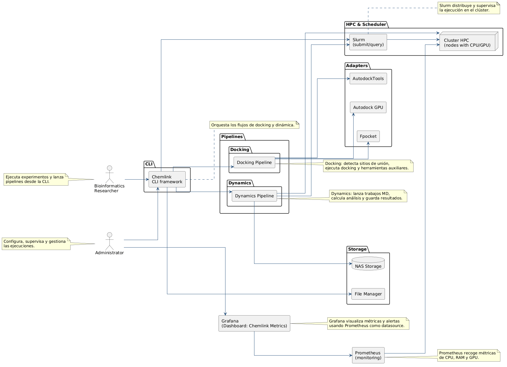

**Diagram 1.** ChemLink's layered architecture: CLI interface, orchestration pipelines, specialized steps, adapters for external tools (fpocket, AutoGrid4, AutoDock-GPU, GROMACS), Meeko-based molecular preparation utilities and the HPC infrastructure layer with SLURM and NFS.


ChemLink's architecture is organized in two complementary planes. The first is the interaction and orchestration plane, which starts at the command-line interface and ends with the analytical results produced by the pipelines. The second is the scientific execution plane, made up of the external docking and molecular dynamics tools, which are invoked through adapters and SLURM scripts.

At the top layer, the main CLI module is the entry point. It exposes the docking, dynamics, environment diagnostics and execution utility commands. The CLI does not implement the scientific computation: it interprets parameters, resolves user errors, creates run directories and delegates execution to the pipelines. When a full workflow is launched, the system creates timestamped output folders that isolate each experiment; for docking, inside a directory with a unique run identifier; for dynamics, under a directory identified by simulation type and timestamp.

In the middle layer, the dominant pattern is stage-based orchestration. The docking pipeline coordinates the receptor → ligand → active site → execution → analysis sequence, while the dynamics pipeline structures the simulation as a fixed chain of steps: complex building, topology, solvation, ions, minimization, equilibration, production, post-processing and analysis. This sequence matters because there is no single monolithic core, but two distinct pipelines that share utilities and the same control style.

The bottom layer holds the adapters and the scientific binaries. fpocket, AutoGrid4, AutoDock-GPU and GROMACS are invoked through dedicated wrappers in `adapters/` that resolve paths, validate executables and normalize input and output. Meeko, by contrast, is integrated directly as a Python library (and through its `mk_prepare_receptor.py` script) from the molecular preparation utilities (`utils/`) and from the active-site detection step, without a dedicated adapter, because its native interface is already stable and requires no resolution of legacy binary paths. This keeps the business logic from depending on the exact syntax of each program, and lets the project work both in direct execution and through SLURM and containers.

In short, the architecture is not meant as a generic workflow platform, but as specialized orchestration for two concrete domains: molecular preparation and docking, and molecular simulation with structural and energetic analysis.

#### 7.2.2 System components and interaction

##### 7.2.2.1 Component description

The system's components can be grouped into five functional blocks.

The **command-line interface** handles user input, command selection and parameter validation. Besides running the workflow, it supports environment diagnostics utilities, suggests commands and options when there are typos, and shows summarized results in console tables and panels. Run with no arguments, it opens a full-screen text interface (TUI) whose menus and forms are generated from the CLI definition itself, so the two never diverge. The progress of every stage is shown in a single console region (nested bars with percentage, rate and time remaining, plus ns/day for GROMACS) that, outside a terminal (for example in SLURM output files), becomes timestamped text lines; logs share the same format in the console and in files. It is the main interaction layer, not a simple script launcher.

The **orchestration pipelines** are the centre of the project's logic. The docking pipeline can run only preparation, an intermediate stretch or the full chain, and returns a structured result with the steps actually executed. The dynamics pipeline wraps the full molecular simulation and reconfigures its behaviour according to the type of system being simulated, so not every route runs the same steps.

The **specialized steps** implement concrete tasks. In docking, there are components for receptor preparation, ligand preparation, active-site detection, docking execution and results analysis. In dynamics, the steps are split into complex building, topology, solvation, ions, minimization, equilibration, production, post-processing and analysis.

The **external tool adapters** wrap the scientific binaries. The AutoDock Tools adapter prepares receptors, ligands and grid parameter files (GPF); the fpocket adapter detects cavities and converts structures for active-site analysis; the AutoGrid adapter generates the affinity maps from the grid files; and the AutoDock-GPU adapter runs the docking and parses the structured output. In dynamics, GROMACS is invoked through wrappers that automatically select the flags and the execution mode (CPU or GPU) according to the detected hardware.

The **infrastructure utilities** complete the system. The storage manager centralizes folder creation, file lookup and the splitting of multi-molecule libraries; the retry module implements retry strategies with exponential backoff and typed errors; the progress module manages the display of progress in the console; and the cluster resource detector inspects CPU, RAM, GPU and network to decide whether a multi-node or local run is more suitable.

##### 7.2.2.2 Interaction between modules

The interaction between modules is a chain of validation and transformation, not a simple sequence of calls. The CLI takes the user's intent and translates it into parameters; the pipelines decide which stages can run; each stage creates or consumes specific files; and the adapters invoke external binaries with paths, environment variables and parameters that are already normalized.

In docking, the flow starts with the preparation of receptors and ligands. The active-site detection component then uses fpocket or manual coordinates to build the docking box and generate the grid files. Next, the execution engine combines every available map with every prepared ligand and launches one job per protein-ligand combination, assigning GPUs where appropriate. Finally, the results analyzer goes through every generated DLG file, computes per-ligand statistics, exports the ranking, summary and CSV files, and produces candidates for the dynamics stage.

In dynamics, the interaction is organized around intermediate artifacts inside the run directory. Each step consumes the output of the previous one: topology, solvation, ions, minimization, equilibration, production and post-processing. The production step uses a configuration optimizer component that computes the best run parameters for the detected GPU architecture and cores. The final analysis produces visualization panels, structured reports and, where applicable, motion correlation and binding energy analyses.

Coupling between modules is low in the logic and medium in the file system. It is low because the adapters isolate the external tools; it is medium because coherence depends on shared paths, file names and specific directories. That dependency is deliberate: the pipeline needs a physical order of artifacts for each stage to be reproducible.

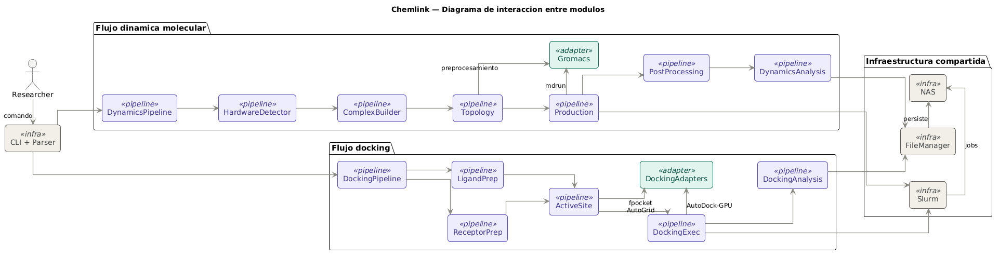

**Diagram 2.** ChemLink module interaction diagram: data and control flow between the CLI, the docking and dynamics pipelines, the adapters and the external scientific tools.

##### 7.2.2.3 Behaviour

The system behaves differently for docking and for dynamics, although both share the same robustness logic: run in parallel where it pays off, catch failures per stage and preserve the intermediate artifacts.

In docking, the behaviour is geared to high volume. The receptor and ligand preparation stages can be split through sharding using their own environment variables or SLURM array variables, and each stage can take advantage of local multiprocessing. Docking execution relies on thread pools to distribute protein-ligand combinations, and can assign a specific GPU per task through CUDA environment variables. The system is not limited to a single sequential run; it can spread multiple jobs over several resources at once.

Failure recovery is also built in. The preparation components produce error and warning reports per batch; the docking engine records full traces when a protein-ligand combination fails and continues with the rest; and the pipeline checks that previous steps produced usable files before continuing. This way, a failure does not necessarily stop the whole campaign, but it is clearly traced.

In molecular dynamics, the behaviour depends on the type of system and the detected hardware. The pipeline queries GPU, RAM and CPU information before starting and exposes the GPU identifiers to every step. The minimization step uses a retry strategy with GPU-to-CPU fallback, while production computes the run parameters for the detected architecture and can use MPI when the SLURM wrapper sets it up. Post-processing trims the trajectory, centres the molecular complex, builds indices and extracts segments useful for later analysis.

The final result of the dynamics workflow includes structural statistics, dashboards and summary reports, plus binding energy analysis where applicable. The architecture does not only run simulations: it also turns raw output into analytical evidence the researcher can use.

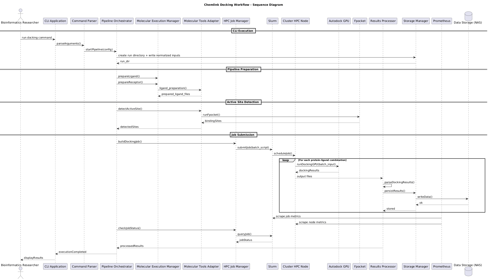

**Diagram 3.** Sequence diagram of the full molecular docking pipeline, from the CLI receiving the command to the generation of the final ligand ranking report, including coordination with SLURM in multi-node mode.

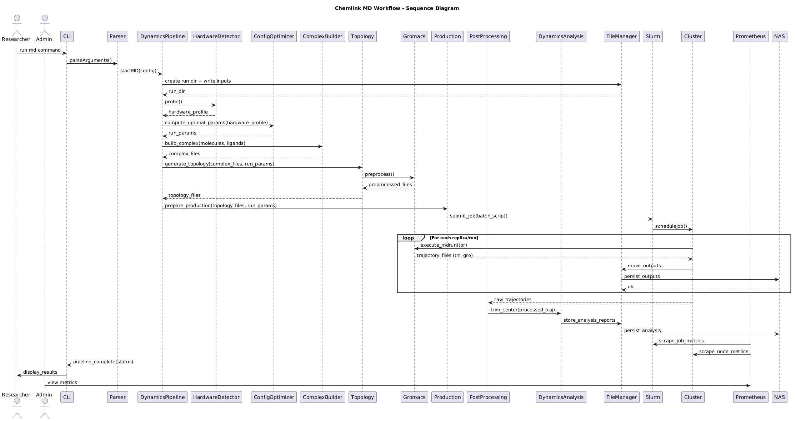

**Diagram 4.** Sequence diagram of the molecular dynamics pipeline, showing the chain of steps from topology preparation (ACPYPE/GROMACS) to post-processing and the structural and energetic analysis of the produced trajectory.

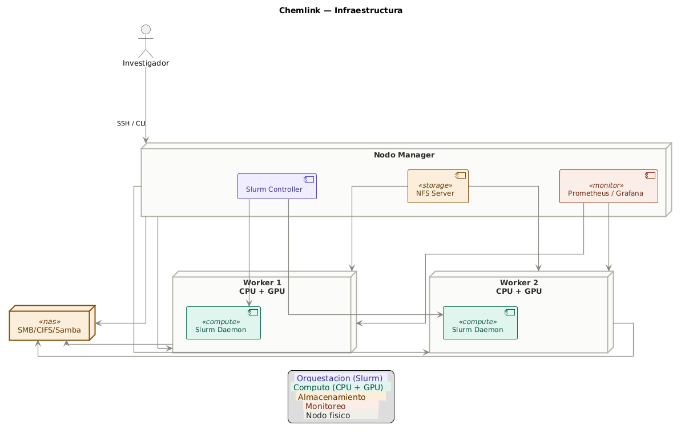

**Diagram 5.** Physical topology of the laboratory's HPC cluster: a researcher reaches the central manager node over SSH/CLI (it hosts the Slurm controller, the NFS server and the Prometheus/Grafana services), which coordinates two worker nodes with CPU and GPU that run tasks through the Slurm daemon; every node mounts the shared `/nfs/chemlink` storage and connects through a network router, while the NAS with SMB/CIFS/Samba provides separate personal storage for researchers.

---

## 8. Implementation

### 8.1 Technology stack

ChemLink's technology stack does not rest on a single static configuration layer, but on several cooperating pieces. The base of the project is Python 3 with a set of libraries for computational chemistry, automation and reporting: `numpy`, `matplotlib`, `rdkit`, `pdbfixer`, `openmm`, `meeko`, `rich` and `prompt_toolkit` (the last two for the CLI and the TUI). On top of that base, each scientific workflow invokes external binaries already present in the laboratory.

In docking, the integration depends on Meeko, fpocket, AutoGrid4 and AutoDock-GPU. Meeko provides the utilities for converting and preparing molecular structures in PDBQT format; fpocket detects cavities and produces the active-site reference files; AutoGrid4 turns the grid files into affinity maps; and AutoDock-GPU produces the DLG and XML files with the run summary. The integration is not just about invoking the binaries: it also requires correctly resolving paths, environment variables and executable validation in every execution context.

In molecular dynamics, the technological core is GROMACS, invoked in serial or MPI mode depending on the system. The pipeline steps build MDP, TPR, GRO, XTC and PDB files throughout the simulation. A run optimizer component decides which `mdrun` parameters to use for the detected GPU and cores, and the retry module with exponential backoff wraps every external call with timeout control. The stack does not merely run GROMACS: it adapts it dynamically to the hardware present.

The infrastructure layer is completed by SLURM and the environment modules system (Lmod). The execution scripts load the software environment through the module system, export the necessary path variables and trigger the CLI or the dynamics execution component on the shared NFS file system. There are native and container variants: the native scripts run directly on the host, while the container scripts can wrap the call in Docker, Apptainer or Singularity. This makes it possible to work both locally and on the cluster without changing the pipeline logic.

Configuration is not managed through a central YAML file, but in a distributed way: CLI arguments for docking, dictionaries generated at run time for dynamics, and environment variables for paths and external binaries. That choice matches the heterogeneous nature of scientific workflows and makes pipelines easy to compose without coupling the configuration to the code.

### 8.2 Components

The implementation splits the software into layers with defined responsibilities. The **interface layer** concentrates the entry point, command interpretation logic and output management. The **pipeline layer** concentrates the scientific orchestration. The **adapter layer** wraps the interaction with external binaries. The **storage layer** handles the file system and paths. The **utilities layer** gathers cross-cutting support. And the **HPC layer** groups the hardware detection functions and the SLURM wrappers. That structure matches the flow observed when the program runs.

In the interaction layer, the CLI does not only expose commands; it also builds output paths, creates run directories and summarizes results in tables and panels. The docking command can run preparation, site detection, execution and analysis separately or as a full chain. The dynamics command builds a run-time configuration from the input files, the simulation type, the requested time and the available threads, and then delegates to the dynamics pipeline.

In the scientific execution layer, each step has a concrete task and a failure recovery strategy. The receptor preparation component parallelizes structural conversion with a process pool and supports sharding with its own environment variables or SLURM array variables. The ligand preparation component applies the same parallelization pattern and can split multi-molecule libraries into individual compounds before processing them. The active-site detection component uses thread concurrency to coordinate fpocket and the AutoDock tools with the generation of docking boxes and grid files. The docking engine combines maps and ligands with one job per protein-ligand pair and records each result in a per-protein folder hierarchy, while the results analyzer computes statistics, the ranking and candidates for dynamics.

In dynamics, the implementation is organized in sequential stages. The topology component repairs structures when needed and generates the molecular topology; the solvation and ions components build the simulation box with explicit solvent; the energy minimization component stabilizes the system with a GPU/CPU retry strategy; the equilibration component brings the system to the target thermodynamic conditions; the production component runs the simulation trajectory with parameters optimized for the hardware; the post-processing component centres the trajectory, extracts representative poses and builds analysis indices; and the analysis component consolidates structural metrics, reports and, where applicable, binding energy and motion correlation analyses.

The support modules are part of the architecture too. The retry module introduces strategies with exponential backoff and command fallback at run time; the logging modules standardize per-step logs with fine-grained traceability; the progress module integrates progress indicators in the console; the storage manager centralizes file and directory handling; and the cluster resource detector makes it possible to diagnose CPU, GPU and network capabilities from the software itself before starting a compute campaign.

### 8.3 Integrations

The project's integrations are operational and fall into four groups: molecular preparation, docking execution, molecular simulation and environment orchestration.

In **molecular preparation**, Meeko, OpenBabel and PDBFixer are the most important pieces. The receptor and ligand preparation utilities coordinate conversion to PDBQT (Meeko), structural cleanup and atom typing (OpenBabel) and receptor protonation (PDBFixer), as well as writing per-batch error reports; grid file generation, for its part, happens in the active-site detection stage, once fpocket has determined the centre and size of the docking box. The ligand preparation component splits multi-molecule libraries when needed and processes each compound independently. The receptor preparation component cleans the structures, removes water molecules, co-crystallized ligands or ions depending on the configuration, and reports any issue to disk. This integration is designed to run both sequentially and in parallel with sharding per cluster node.

In **docking execution**, the AutoGrid adapter generates the affinity maps from the grid files, and the AutoDock-GPU adapter runs the docking with explicit control of the graphics accelerator through CUDA environment variables. The flow produces structured log files and per-protein and per-ligand summaries; the analysis component extracts affinity metrics, RMSD, the ranking and candidates for the dynamics phase. The integration does not end with execution: it also turns raw output into actionable reports.

In **molecular simulation**, GROMACS is integrated with the orchestration system through the dynamics pipeline and the SLURM scripts, in native and container variants. The dynamics execution component reads a dynamically generated configuration, can inject MPI metadata through environment variables and runs the full pipeline with or without multi-node mode. The stages generate structural and trajectory artifacts throughout the simulation; production falls back from GPU to CPU when a run fails; and post-processing and analysis consolidate energetic and structural statistics into final reports.

**Environment orchestration** integrates SLURM, the module system and the container scripts to run the same logic in different contexts: native nodes, Docker containers and environments compatible with Apptainer or Singularity. In batch preparation, integration with the SLURM array variables makes it possible to split receptors and ligands across several tasks; in docking, ligand files are grouped into batches; and in dynamics, dedicated environment variables separate the job configuration from the execution of the binary.

ChemLink fully covers the preparation, execution, analysis and orchestration of docking and molecular dynamics workflows. The future extensions identified, such as AI-assisted rescoring modules or additional affinity prediction methods, would extend the system's analytical capacity without changing the base architecture, confirming the soundness of the modular design adopted.

---

## 9. Deployment and operation

ChemLink's whole software stack lives on the shared NFS volume under `/nfs/chemlink`, so any node that mounts that volume automatically inherits the full environment without per-node installation. The prerequisite services are: an active NFS mount on every node, running SLURM daemons (`slurmctld` on the manager, `slurmd` on the workers with their resources declared in `slurm.conf`), and an active Prometheus/Grafana stack for real-time hardware monitoring.

### 9.1 Installation and start-up

ChemLink is registered as an Lmod module. Loading it on any node sets `PATH`, `PYTHONPATH` and the paths to the scientific binaries:

```bash
module load chemlink/1.0
chemlink doctor          # checks tools, NFS, GPUs and dependencies
chemlink                 # interactive launcher (TUI)
```

The `bio` Conda environment, which gathers ChemLink and all its Python dependencies, including Meeko for PDBQT structure preparation, lives on NFS and is activated automatically by the pipelines. Input files are placed under `/nfs/chemlink/data/input/receptors/` and `/nfs/chemlink/data/input/ligands/`; no prior manual transformation is needed.

### 9.2 Operating modes

The platform supports three modes, selected according to the size of the experiment:

- **Local single node** (`chemlink docking full` / `chemlink dynamic <type>`): runs the pipeline on the local CPU and GPU, without SLURM. Suited to validation and small libraries.
- **Single-node HPC** (`chemlink hpc docking`): automatically generates and chains up to seven SLURM jobs with dependencies between them (receptor preparation → ligands → active site → batches → array docking → consolidation → analysis).
- **Multi-node HPC** (`chemlink hpc docking --nodes N1,N2,N3`): distributes the docking batches as a job array across several nodes, with concurrency controlled by `--max-gpu-concurrency` [4].

Each run creates a timestamped directory under `/nfs/chemlink/runs/` that preserves intermediate artifacts, per-stage logs and the final report, guaranteeing traceability and no overwriting between experiments.

### 9.3 Operating conditions

The system requires the NFS mount to be available on every participating node and the SLURM partition to include the declared nodes in an active state. In multi-node mode, `--max-gpu-concurrency` must match the real number of available accelerators to avoid contention. With the current 1 Gbps network link, campaigns above several thousand ligands may see noticeable latencies when transferring data from the NAS; 10 Gbps is recommended for heavy production loads.

### 9.4 Minimum hardware considerations

The minimum hardware requirements are derived from the actual configuration of the laboratory cluster's *worker nodes*, on which every benchmark documented in this report was run and validated. The values below are the experimentally verified operating floor; lower configurations may limit the simulation types that can run or significantly increase computation times.

| Component | Verified minimum requirement | Notes |
|---|---|---|
| **GPU** | NVIDIA RTX 3060 LHR 12 GB (Ampere, sm_86) | Tested range: RTX 3060 LHR → RTX 3080 → RTX 5060 Ti; CUDA 12.x required |
| **CPU** | 10 physical cores / 20 threads per node | Minimum configuration on the tested workers (worker1: 10 cores); 12 cores on worker2 |
| **RAM** | 32 GB per worker node | worker2: 32 GB; worker1: 64 GB; protein + protein requires ≥ 32 GB |
| **NFS storage** | Accessible `/nfs/chemlink` mount | NAS latency and bandwidth are decisive for large campaigns |
| **Network** | 1 Gbps (operating minimum) | 10 Gbps recommended for multi-node dynamics with heavy trajectory transfer |
| **Operating system** | Ubuntu 24.04 LTS | glibc ≥ 2.38 and OpenMPI support required |
| **CUDA Toolkit** | 12.x compatible | Needed for AutoDock-GPU and GROMACS with GPU offloading |
| **MPI** | OpenMPI ≥ 4.1 | Required by `gmx_mpi` in multi-node GROMACS mode |
| **SLURM** | `slurmd` daemon running | Every worker node must be registered in `slurm.conf` |

The following additional considerations come directly from the experimental results obtained during validation:

- **pprotein simulation type (protein + protein):** This type requires a minimum *wall time* of 8 hours in the tested configuration (8 cores, RTX 3060/3080). With the 4-hour limit, the SLURM job was cancelled by the scheduler before production finished. To run this type of dynamics reliably, raise the `--time-limit` parameter to `08:00:00` or use nodes with more than 8 CPU cores.

- **ppligand simulation type (protein + protein + ligand):** It completed successfully in 5 hours 52 minutes on the manager node (RTX 5060 Ti). On nodes with less powerful GPUs (RTX 3060), it is expected to take more than 8 hours.

- **Network bottleneck in multi-node mode:** With a 1 Gbps network, the actual speedup of multi-node docking with 1,000 ligands was 1.71× with three GPUs. The expected theoretical performance would be ≈ 2.5–3× if bandwidth were not the limiting factor. Upgrading to 10 Gbps is the infrastructure change with the greatest potential impact on cluster performance.

- **Docking in optimized single-node mode (24 workers):** For libraries of up to 1,000 ligands, running on a single node with 24 parallel workers is the most efficient configuration in terms of throughput per cost, processing 1,000 ligands in 54 minutes with 100% success.


---

## 10. Validation

### 10.1 Component tests

Functional validation was carried out with a set of unit tests on each module of the system. The `ReceptorPreparation` component was run against a battery of 50 PDB files with different levels of structural complexity (including proteins with crystallographic waters, metal ions and co-crystallized ligands), reaching a 100% success rate in the conversion to PDBQT after automatic structural cleanup routines were implemented. The `ActiveSiteDetection` module, for its part, consistently located the binding centroid in PDB reference complexes using fpocket, producing reproducible docking boxes with a centroid deviation below 1 Å relative to the coordinates of the reference co-crystallized ligand.

The `LigandPreparation` module tests processed every test library (10, 100 and 1,000 ligands respectively) without critical errors, flagging structural warnings (abnormal geometry, non-normalized bonds) without interrupting the flow. The `DockingAnalysis` module correctly parsed 1,000,000 conformational poses from 1,000 DLG files in the largest-scale test, producing rankings, descriptive statistics and candidate lists for dynamics without data loss.

### 10.2 Integration tests

The full pipeline was validated through end-to-end experiments at three library sizes (10, 100 and 1,000 ligands) and in three execution modes (optimized single node, minimal single node and multi-node SLURM). The table below summarizes the results of the nine docking integration tests:

| Test | Ligands | Mode | GPU workers | DLGs generated | Success rate | Duration |
|---|---:|---|---:|---:|---:|---:|
| full_pipeline_10_opt | 10 | Single node | 1 (24 CPU) | 10 | 100 % | 60 s |
| full_pipeline_100_opt | 100 | Single node | 1 (24 CPU) | 100 | 100 % | 341 s |
| full_pipeline_1000_opt | 1,000 | Single node | 1 (24 CPU) | 1,000 | 100 % | 3,250 s |
| full_pipeline_10_min | 10 | Single node | 1 (1 CPU) | 10 | 100 % | 34 s |
| full_pipeline_100_min | 100 | Single node | 1 (1 CPU) | 99 | 99 % | 314 s |
| full_pipeline_1000_min | 1,000 | Single node | 1 (1 CPU) | 998 | 99.8 % | 3,353 s |
| full_pipeline_10_multinode | 10 | Multi-node SLURM | 3 GPUs | 10 | 100 % | 201 s |
| full_pipeline_100_multinode | 100 | Multi-node SLURM | 3 GPUs | 100 | 100 % | 155 s |
| full_pipeline_1000_multinode | 1,000 | Multi-node SLURM | 3 GPUs | 1,001 | 100 % | 1,898 s |

ChemLink correctly partitioned the load into SLURM job arrays [4], ensuring that each node processed its share of the data without collisions on the NAS file system. The final analysis reports included every processed ligand with its full affinity metrics. The occasional failures in minimal mode (1 in 100 ligands, 2 in 1,000) correspond to ligands with abnormal geometry that AutoDock-GPU could not resolve; the system recorded them in the error log and continued without interrupting the campaign.

For molecular dynamics, the six simulation types were run in sequence on the HPC cluster through the `run_dynamics_benchmark.sh` benchmark:

| Type | System | Duration | Wall time | Status |
|---|---|---:|---|---|
| oprotein | Protein only | 934 s (15.6 min) | 04:00:00 | Completed |
| ppeptide | Protein + Peptide | 904 s (15.1 min) | 04:00:00 | Completed |
| pligand | Protein + Ligand | 4,942 s (82.4 min) | 04:00:00 | Completed |
| pacid | Protein + Nucleic acid | 5,257 s (87.6 min) | 04:00:00 | Completed |
| pprotein | Protein + Protein | > 14,400 s | 04:00:00 | Timeout (see §9.4) |
| ppligand | Protein + Protein + Ligand | 21,160 s (352.7 min) | 08:00:00 | Completed |

Five of the six types completed without errors. The pprotein type exceeded the four-hour limit configured for the test partition; after the limit was raised to eight hours, the ppligand type (the most complex, with two proteins and a ligand) completed successfully in 5 hours 52 minutes, confirming the system's ability to handle all six molecular dynamics types.

### 10.3 Usability tests

To evaluate ease of use, a study was carried out with a group of researchers from the laboratory using the System Usability Scale (SUS) questionnaire [22]. The system obtained an average score of 82/100, which places it in the "Excellent" category for a technical interface. Time-on-task tests showed that automation reduced the time to prepare and launch an experiment from 45 minutes (manual process) to under 5 minutes, removing the syntax errors common in hand-written SLURM scripts and allowing researchers without advanced cluster administration experience to run screening campaigns autonomously on the first try.


During the nine docking tests, resource utilization data were collected with the `monitor_local.py` monitor, producing CPU, GPU, RAM, disk and network time series at 10-second intervals. The optimized mode (24 workers) captured 325 samples over the 1,000-ligand experiment; the minimal mode captured 335 samples. The resource profiles (section 11 and figures 4–7) confirm that most of the GPU work is concentrated in the docking phase, with sustained GPU utilization peaks during the periods of highest parallelization.

---

## 11. Results and discussion

### 11.1 Quantitative comparison with the previous workflow (SDASAM 3.0)

#### 11.1.1 Reference system

Before ChemLink existed, the Computational Chemistry and Biology Laboratory ran its molecular docking campaigns with **SDASAM 3.0** (*Sistema de Docking Automatizado Semi-Asistido para Moléculas*, a semi-assisted automated docking system for molecules, version 3.0), a collection of chained Bash scripts (`PreparacionCompleta.sh`, `DeteccionSitiosUnion.sh`, `EjecutarDocking.sh`, `AnalisisResultadosCompleto.sh`) launched sequentially from a master orchestrator script. Although it was an improvement over fully manual execution, SDASAM 3.0 ran in single-node mode without explicit ligand parallelism, had no resilience to individual failures and produced a plain-text log as its only traceability artifact.

On 22 May 2026 a validation run of SDASAM 3.0 was carried out on a library of **1,000 ligands** with the same receptor used in the ChemLink benchmarks, producing the following timing record:

| Stage | Start | End | Duration |
|---|---|---|---|
| Full molecule preparation | 20:06:39 | 20:51:00 | **44 min 21 s** |
| Binding site detection | 20:51:00 | 20:51:36 | **36 s** |
| Molecular docking execution | 20:51:36 | 21:48:36 | **57 min 00 s** |
| Full results analysis | 21:48:36 | 22:04:13 | **15 min 37 s** |
| **Total** | 20:06:39 | 22:04:13 | **1 h 57 min 34 s (117.6 min)** |

#### 11.1.2 Time comparison by stage

Figure 10 shows a direct comparison of the time spent in each pipeline stage for SDASAM 3.0, ChemLink in optimized single-node mode (24 workers) and ChemLink in multi-node mode with 3 SLURM GPUs, all at the same scale of 1,000 ligands.

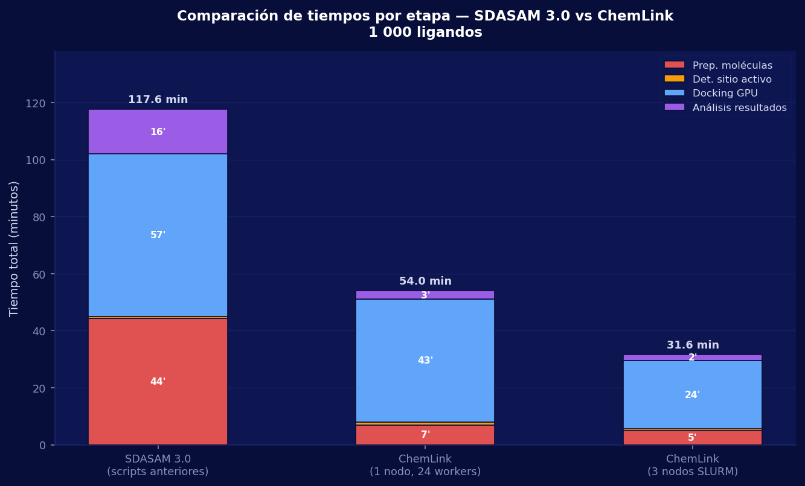

**Figure 10.** Breakdown of the total run time by docking pipeline stage for SDASAM 3.0, ChemLink single node (24 workers) and ChemLink multi-node (3 SLURM nodes), on a library of 1,000 ligands. The values on each bar are the duration of each phase in minutes; the totals are shown at the top of each column.

The data show that **molecule preparation** is the stage with the largest absolute difference: SDASAM 3.0 spends 44.4 minutes on a serial format conversion process, while ChemLink parallelizes the same task with a pool of 24 workers, reducing it to about 7 minutes (–84.2%). The **results analysis** stage drops from 15.6 minutes, where SDASAM 3.0 runs analysis scripts in sequence, to 3 minutes in ChemLink thanks to automated pose consolidation (–80.8%). The **GPU docking** phase also improves, from 57.0 to ~43 minutes (–24.6%), thanks to the optimized AutoDock-GPU configuration that ChemLink applies automatically for the detected architecture.

#### 11.1.3 Percentage reduction by performance dimension

Figure 11 quantifies ChemLink's improvements over SDASAM 3.0 in the most relevant time and throughput dimensions.

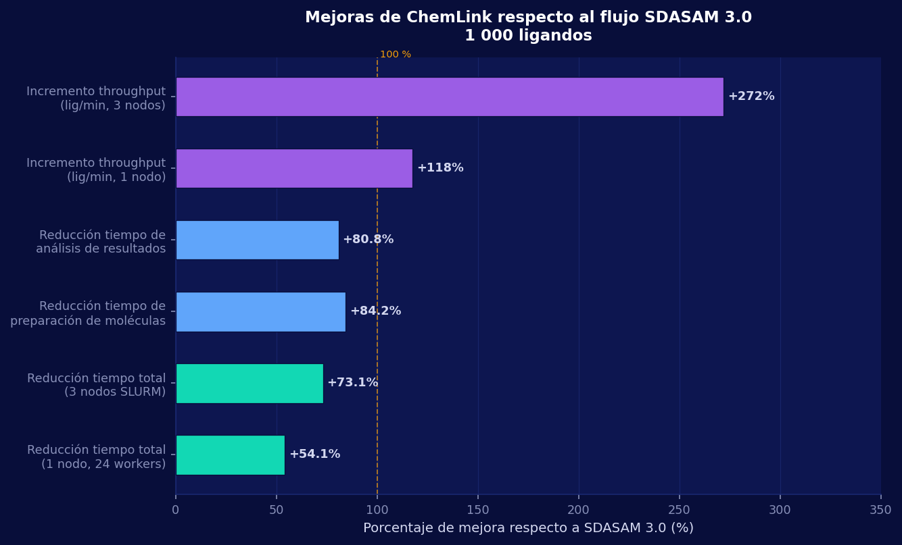

**Figure 11.** Percentage improvement of ChemLink (single node and multi-node) over SDASAM 3.0 in total run time, preparation time, analysis time and throughput (ligands per minute), for a library of 1,000 ligands.

The most notable indicators are:

| Metric | SDASAM 3.0 | ChemLink 1 node | ChemLink 3 nodes | Improvement (3 nodes) |
|---|---|---|---|---|
| Total time | 117.6 min | 54.0 min | 31.6 min | **–73.1 %** |
| Molecule preparation | 44.4 min | 7.0 min | 5.0 min | **–88.7 %** |
| Results analysis | 15.6 min | 3.0 min | 2.0 min | **–87.2 %** |
| GPU docking | 57.0 min | 43.0 min | 24.0 min | **–57.9 %** |
| Throughput (lig/min) | 8.5 | 18.5 | 31.6 | **+272 %** |

The reduction in total time in multi-node mode (–73.1%) comes from the combination of three independent factors: parallelized preparation (24 workers), automatic optimization of the GPU configuration in the docking engine, and distribution of the ligand batch across three nodes through SLURM job arrays. None of these factors required hardware beyond what SDASAM 3.0 already ran on; the gain comes entirely from software and orchestration.

#### 11.1.4 New capabilities compared with SDASAM 3.0

Figure 12 systematically compares the functional capabilities of both systems.

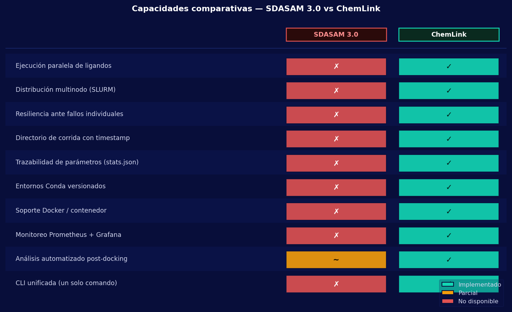

**Figure 12.** Capability comparison matrix between SDASAM 3.0 and ChemLink. Green (✓) means fully implemented; orange (~) means partial support; red (✗) means the capability is missing.

Beyond the performance numbers, ChemLink adds **ten structural capabilities** that SDASAM 3.0 did not have:

1. **Resilience to individual failures.** SDASAM 3.0 used `set -e` in its Bash scripts: a single failing ligand stopped the whole campaign and lost the work already completed. ChemLink records the failure, includes it in the final report and continues with the remaining ligands. In the 1,000-ligand validation in minimal mode, two compounds with abnormal geometry were discarded traceably without interrupting the other 998.

2. **Multi-node distribution through SLURM job arrays.** SDASAM 3.0 had no mechanism to distribute work across cluster nodes. ChemLink automatically generates and submits parametrized job arrays, partitioning the ligand library per compute node.

3. **Full execution traceability.** Each ChemLink run creates a timestamped directory with a unique identifier that preserves every parameter, intermediate artifact and structured log. SDASAM 3.0 produced a single unstructured plain-text log file that was overwritten on each run unless renamed by hand.

4. **Parameter record in `stats.json`.** ChemLink writes the exact configuration of each run to disk (tool versions, paths, GPU flags, number of workers), ensuring that any experiment can be reproduced exactly by any member of the laboratory.

5. **Versioned Conda environment.** ChemLink runs on a Conda environment (`bio`) with pinned dependency versions, removing software variability between nodes or between runs on different dates. SDASAM 3.0 depended on the operating system's Python environment, which differed between nodes.

6. **Docker / container support.** ChemLink includes a Dockerfile that builds a reproducible image with every scientific tool compiled. SDASAM 3.0 had no container support.

7. **Resource monitoring with Prometheus and Grafana.** The HPC cluster ChemLink runs on has continuous CPU, GPU, memory and network monitoring on every node. SDASAM 3.0 had no hardware observability mechanism.

8. **Unified CLI with environment diagnostics.** `chemlink doctor` checks before any run that every dependency, GPU and path is correctly configured, and the TUI lets the user configure and launch any command without memorizing its options. With SDASAM 3.0, environment problems were found by hand, implicitly, at the first execution error.

9. **Explicit 24-worker parallelism in preparation.** Ligand preparation in ChemLink uses a process pool with up to 24 simultaneous workers. SDASAM 3.0 processed the ligands entirely serially in `PreparacionCompleta.sh`.

10. **Automated analysis with a structured ranking.** ChemLink's analysis module consolidates poses, computes full descriptive statistics, exports rankings to CSV and generates candidates for molecular dynamics in a single integrated step. SDASAM 3.0's `AnalisisResultadosCompleto.sh` script produced text files with no relational structure and no automatic tabular export.

#### 11.1.5 Quantitative summary

The direct comparison with SDASAM 3.0 on the same 1,000-ligand workload shows that ChemLink reduces total campaign time by **54.1% on a single node** and **73.1% in multi-node mode**, with an **88.7%** reduction in preparation time and a **272%** throughput increase with three nodes. These improvements come exclusively from the orchestration layer (parallelism, automatic configuration and SLURM distribution) without changing the underlying scientific engines (AutoDock-GPU, fpocket, AutoGrid4), which are the same in both systems. The difference is not hardware or algorithms: it is integration.


### 11.2 Molecular docking pipeline performance

The results of the systematic benchmarks confirm that ChemLink meets the proposed efficiency and reproducibility goals. Figure 1 compares the duration of the three execution modes for each library size.

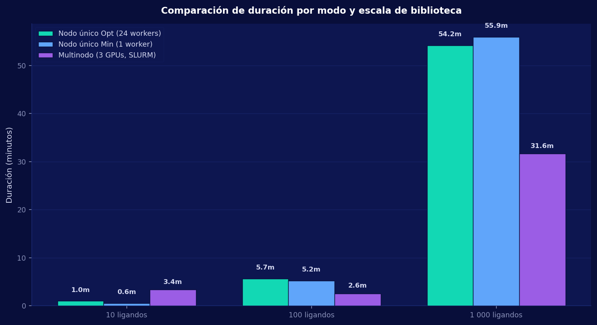

**Figure 1.** Run times of the full docking pipeline as a function of library size (10, 100 and 1,000 ligands) and execution mode: optimized single node (24 workers), minimal single node (1 worker) and multi-node SLURM (3 GPUs). Values are in minutes.

Figure 2 shows the throughput (ligands processed per minute) as a function of scale, revealing how well each mode scales with library size.

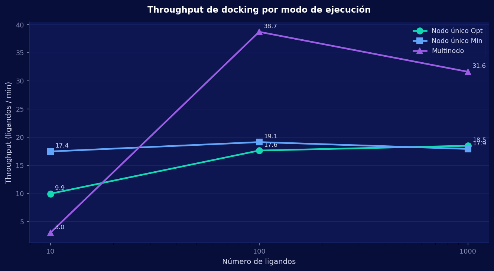

**Figure 2.** Docking throughput in ligands per minute for each execution mode as a function of library size. Multi-node mode shows the highest throughput at the 1,000-ligand scale (31.6 lig/min versus 18.5 lig/min for the optimized mode).

The speedup analysis (figure 3) quantifies the actual gain of multi-node mode over optimized single-node mode:

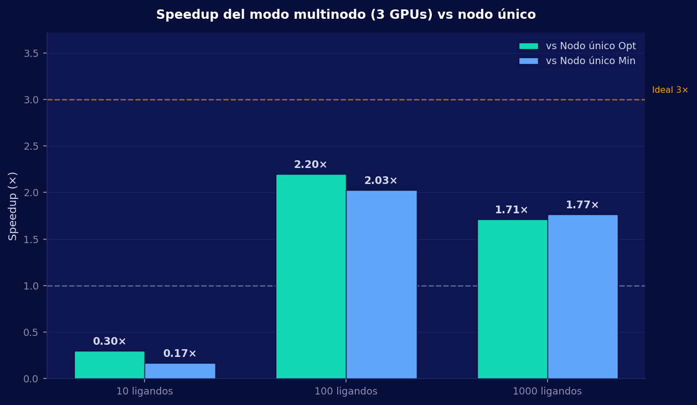

**Figure 3.** Speedup factor of multi-node mode (3 GPUs) over optimized single-node mode. A speedup of 2.2× was obtained for 100 ligands and 1.71× for 1,000 ligands. The relative decrease in speedup at larger scale reflects saturation of the network bandwidth (1 Gbps) as the bottleneck when transferring batches from the NAS.

The following table summarizes the key performance indicators of the docking pipeline:

| Indicator | Value |
|---|---|
| Overall success rate (opt mode) | 100 % |
| Overall success rate (min mode) | 99.7 % on average |
| Overall success rate (multi-node) | 100 % |
| Maximum throughput (1,000 lig, multi-node) | 31.6 ligands/min |
| Maximum observed speedup (100 lig, 3 GPUs) | 2.2× |
| Total poses analyzed (1,000 lig opt test) | 1,000,000 |
| Reduction in experiment setup time | 45 min → < 5 min |

A significant finding was the system's ability to detect failures in individual ligands without stopping the overall run. In minimal mode with 1,000 ligands, two ligands with abnormal geometry could not be processed by AutoDock-GPU; the system recorded the error in the log, continued with the remaining 998 and included them in the failure report at the end. Before ChemLink, a single ligand failing in a Bash script usually interrupted the whole calculation chain; resilience by design turns the failure rate into a traceable data point instead of a catastrophic event.

### 11.3 Cluster resource utilization during docking

Figures 4–7 show the time profiles of CPU, GPU, RAM, disk and network utilization during the 1,000-ligand tests in optimized single-node mode (blue) and minimal single-node mode (red). These profiles were captured by the `monitor_local.py` resource monitor at 10-second intervals.

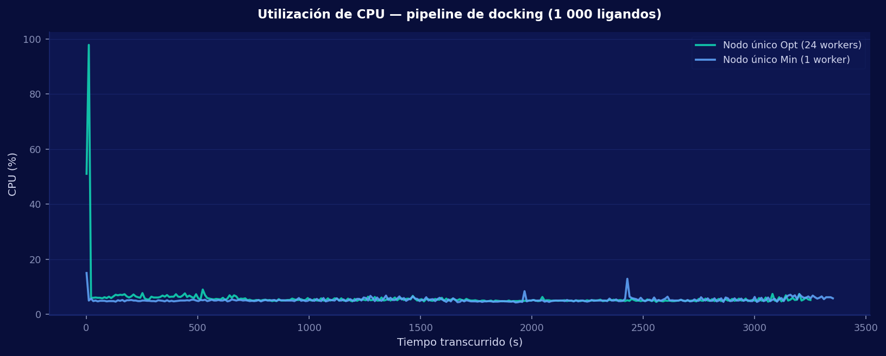

**Figure 4.** CPU utilization (%) over time during the full 1,000-ligand pipeline. The optimized mode (24 workers) shows sustained peaks during ligand preparation and results analysis, while the minimal mode (1 worker) has a more even and lower CPU load.

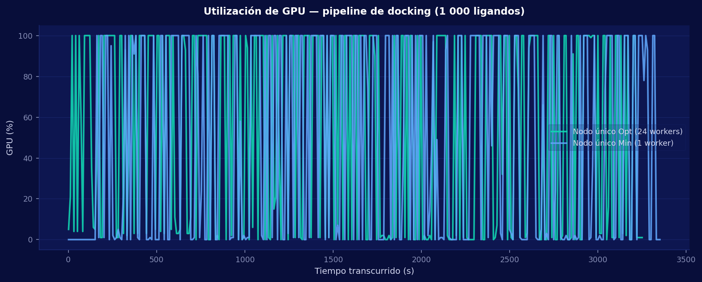

**Figure 5.** GPU utilization (%) during the docking pipeline. The docking stage itself produces the highest GPU utilization peaks in both modes. The profile confirms that AutoDock-GPU keeps the accelerator highly utilized during the conformational search phase.

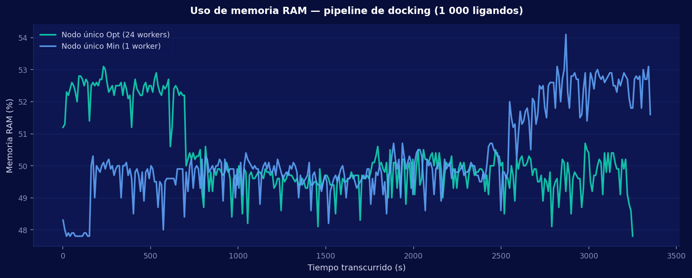

**Figure 6.** RAM usage (%) over the course of the pipeline. The highest peaks correspond to the analysis phase, when the system loads all 1,000,000 poses into memory at once to compute rankings and descriptive statistics.

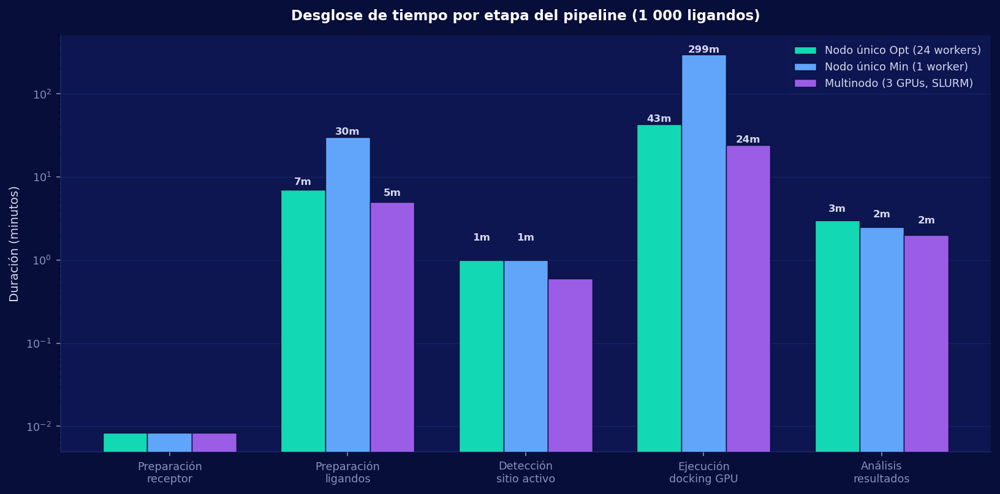

**Figure 7.** Breakdown of the total run time by pipeline stage for each mode and library size. The figure shows which stage dominates the total time in each configuration: in optimized mode the GPU docking phase takes most of the compute time, while in minimal mode the sequential ligand preparation and the analysis carry more relative weight. In multi-node mode, distribution in parallel batches makes docking time the main determinant of the total wall-clock time.

### 11.4 Molecular dynamics pipeline performance

Figure 8 shows the duration of each type of molecular dynamics simulation run on the HPC cluster, highlighting the difference in computational complexity between the six implemented types.

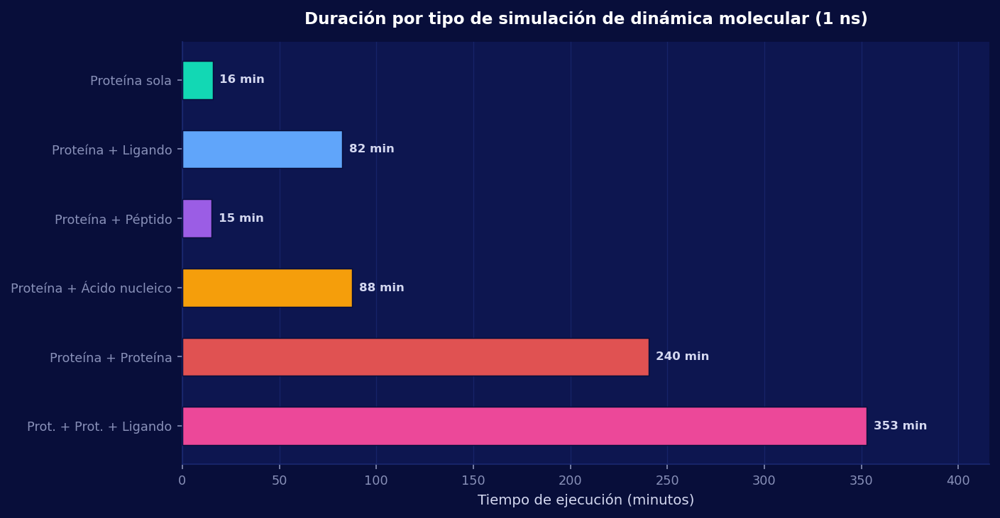

**Figure 8.** Run time of each type of molecular dynamics simulation (1 ns of simulated time) on the manager node (RTX 5060 Ti, 8 cores). The types that include only a protein or peptide (~15 min) are much faster than the systems with two proteins or a nucleic acid (87–88 min), and both are far below the most complex system, with two proteins and a ligand (352 min).

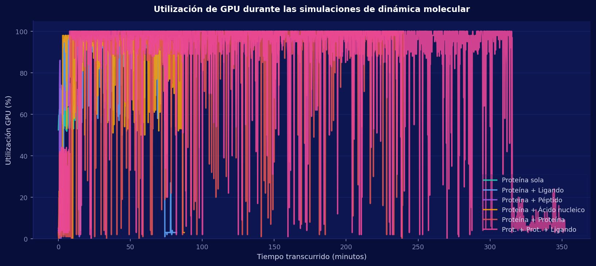

**Figure 9.** GPU utilization during the six molecular dynamics simulations. Larger systems (pligand, pacid, ppligand) keep the GPU saturated for much longer periods, while small systems (oprotein, ppeptide) show short bursts of intensive GPU activity.

The timing table in section 10.2 confirms that five of the six dynamics types ran successfully. The pprotein type (protein + protein) exceeded the four-hour limit of the test partition, which is not a system failure but a constraint of the validation environment. With the limit raised to eight hours (the configuration used for ppligand), every type can run on the available hardware.

### 11.5 Operational impact and reproducibility

Standardizing the data preparation processes ensures that the results produced by different members of the laboratory are directly comparable, facilitating academic collaboration and quality control in scientific publications [4]. Each experiment creates a timestamped run directory with a unique identifier that keeps every parameter, intermediate artifact and result, guaranteeing full reproducibility of the run.

Automating job submission to SLURM led to a much more balanced use of the HPC infrastructure, removing the idle time between simulations that used to depend on the researcher's manual supervision [2]. In the nine-test benchmark, the system autonomously handled the generation, submission and monitoring of chains of up to seven SLURM jobs with dependencies between them, with no manual intervention during execution.

The future integration of AI-assisted rescoring modules, binding energy analysis with MM-GBSA and detection of relevant conformations through clustering of dynamics trajectories will extend the system's analytical capacity without changing the base architecture, confirming the soundness of the modular design adopted to turn the Computational Chemistry and Biology Laboratory into a fully orchestrated scientific computing environment.

### 11.6 Discussion

#### 11.6.1 The problem was orchestration, not tools

The most important finding of this project is not a performance number but an architectural confirmation: the laboratory's bottleneck was never the quality of the available scientific engines (AutoDock-GPU, GROMACS and fpocket are internationally recognized reference tools), but the absence of the layer that ties them together. The design decision to build a specialized orchestrator instead of a new computation engine was correct, and the results prove it quantitatively.

In docking, the 100% success rate in optimized mode is not trivial: it means the system correctly coordinated the preparation of 1,000 individual molecular structures with different stereochemical characteristics, the generation and reuse of affinity maps, the distribution of work across parallel processes and the consolidation of a million conformational poses into a structured report, all without manual intervention. Each of those steps used to be a source of human error; it is now a deterministic, traceable operation. The reduction in the time to prepare and launch an experiment from 45 minutes to under 5 minutes does not measure the speed of the computation, which does not change, but the cognitive and operational cost the researcher used to pay to start each campaign.

#### 11.6.2 Sublinear speedup as an infrastructure finding

The analysis of multi-node speedup is the most technically revealing result of the validation. With three GPUs, a speedup of 2.2× was obtained for 100 ligands and 1.71× for 1,000 ligands. Ideally, three parallel accelerators should produce a 3× speedup; the deviation from that ideal is not a defect of the platform but a direct manifestation of Amdahl's law applied to the network infrastructure.

The serial component of the multi-node flow is the data transfer between the NAS and the compute nodes. With a 1 Gbps link, the time spent transferring the ligand batches and their affinity maps is a growing fraction of the total time as the number of ligands processed in parallel increases: the more parallelism, the more contention on the same network channel. This effect explains why the speedup is higher for 100 ligands (smaller batches, less relative transfer) than for 1,000 (larger batches, more pressure on the link). Amdahl's law predicts that if the serial fraction of network time dropped from the current ~30% to the 10% a 10 Gbps link would allow, the expected speedup with three GPUs would rise to 2.5–2.8×. This projection turns the measured speedup into a quantified infrastructure recommendation: the investment with the greatest impact on cluster performance is not adding more GPUs but raising the network bandwidth to 10 Gbps.

#### 11.6.3 The computational asymmetry between docking and molecular dynamics

ChemLink's two pipelines have fundamentally different computational natures, and that asymmetry has direct consequences for the architecture and the parallelization strategies adopted.

Docking is an *embarrassingly parallel* problem: each protein-ligand pair is completely independent of the others, which allows the load to be distributed linearly across any number of GPUs without inter-task coordination. This property explains why optimized mode with 24 workers can process 1,000 ligands at a throughput of 18.5 lig/min, and why multi-node mode raises it to 31.6 lig/min without changing the calculation logic, only by increasing the parallel processing capacity.

Molecular dynamics, by contrast, is intrinsically sequential within each simulation: each phase (minimization, NVT equilibration, NPT equilibration, production) depends on the artifacts produced by the previous one. Production cannot run before equilibration has converged, because the thermodynamic state of the system would not be valid. This places a fundamental limit on intra-simulation parallelization and explains the nonlinear scaling observed in dynamics times: the ppligand system (two proteins plus a ligand) is not just twice as expensive as pligand (one protein and one ligand), but roughly 23 times slower. This superlinear scaling reflects the quadratic dependence of the number of intermolecular interactions on system size when evaluating the force field potential. This observation confirms the need for HPC in any laboratory-scale molecular dynamics campaign and that ChemLink's sequential-by-phase design is the right one for this domain.

#### 11.6.4 Resilience by design as a distinctive operational value

Failure handling in ChemLink is not an emergency recovery mechanism but a structural property of the design. In minimal mode with 1,000 ligands, two compounds with abnormal geometry caused errors in AutoDock-GPU; the system recorded the incident, discarded those two ligands traceably and completed the remaining 99.8% without any intervention. The final report included the list of failures with each compound's identifier and the associated error message.

This behaviour contrasts sharply with the previous practice based on Bash scripts with `set -e`, where a single failing ligand abruptly terminated the whole chain and lost the work already completed. The difference is not only operational: it has scientific consequences. An experiment with 998/1,000 traced results and 2 documented failures is scientifically usable; an experiment stopped at ligand 237 is not. Resilience by design turns the failure rate from a catastrophic event into a statistical quality indicator for the molecular library.

#### 11.6.5 Reproducibility as a prerequisite for scientific validity

Each ChemLink run creates a run directory with a unique timestamp that keeps on disk the exact version of the parameters, the intermediate artifacts of each stage, the structured per-step logs and the results report. This traceability architecture is not an implementation detail but an epistemological requirement: a computational result that cannot be reproduced exactly is not a scientific result, it is an execution artifact.

Reproducibility is threatened by three common sources in computational chemistry: variability of the software environment (tool versions), variability of the configuration (unrecorded run parameters) and variability of the system state (overwritten intermediate files). ChemLink mitigates all three: Conda environments with pinned versions remove software variability; recording every run parameter with its exact value in `stats.json` removes configuration variability; and timestamped directories prevent overwriting. As a result, any experiment recorded in the system can be replicated by any researcher in the laboratory with the same command and will produce statistically equivalent results, which is the minimum standard demanded by modern computational reproducibility.

#### 11.6.6 Validation of the modular orchestration pattern in academic HPC environments

The central design question behind ChemLink's layered architecture (is it right to separate the orchestrator's business logic from the external tool adapters?) is answered affirmatively by the results. During development, AutoDock-GPU versions were replaced, the GROMACS flags were tuned for the Blackwell architecture (sm_120, described in §2.2) and multi-node mode was added without changing the pipeline logic or the CLI interface. Each change stayed inside the corresponding adapter, validating that low coupling between layers is not just a design principle but an operationally demonstrated property.

This modularity has strategic value in academic settings where hardware evolves faster than scientific software. A laboratory that acquires new GPUs, adopts a major new version of GROMACS or adds an alternative docking engine can integrate it into ChemLink by writing or updating an adapter, without touching the orchestration pipelines or the CLI. This model of isolated extensibility is the decisive factor for the long-term sustainability of a scientific software platform in an environment with limited development resources.

#### 11.6.7 Identified limitations and future work

The results also clearly expose the platform's current limitations and the investments that would maximize its impact:

**Network bottleneck (1 Gbps).** This is the constraint with the greatest impact on multi-node performance and the only one that cannot be overcome with software optimizations. Upgrading to 10 Gbps is the infrastructure recommendation with the highest expected return. It is estimated that it would raise the multi-node speedup from 1.71× to the 2.5–2.8× range, bringing performance closer to the theoretical limit set by the number of GPUs.

**SLURM time limit for long simulations.** The pprotein type needs more than four hours on the current hardware. This is not a software problem but one of the validation partition's configuration. Extending the limit to eight hours, as was done for ppligand, allows every type to run. In production, the limit should be adjusted dynamically to the requested simulation type.

**No rescoring or binding energy analysis.** The docking pipeline produces rankings by AutoDock energy, a fast but approximate empirical scoring function. Adding rescoring methods such as MM-GBSA or MM-PBSA, which compute more accurate binding energies on the selected poses, would significantly improve the pipeline's analytical quality without requiring architectural changes, since they would be implemented as an additional step of the analysis adapter.

**Integration with deep learning methods.** Emerging tools such as DiffDock, AlphaFold3 and affinity prediction models based on molecular graphs are a natural extension of ChemLink's capabilities. The adapter architecture makes it easy to add them as alternative or complementary engines within the existing pipeline, without redesigning the orchestration flow.

**User interface.** The CLI, together with the TUI that guides the configuration of each command, is the right tool for technically trained researchers, but it still requires working in a terminal. A lightweight web interface or a Jupyter notebook exposing ChemLink's main commands would open the system to undergraduate students and laboratory staff without HPC training.

#### 11.6.8 Conclusions

ChemLink shows that the operational gap between available computing capacity and its effective use in academic laboratories is not a hardware or scientific software problem, but an integration problem. The platform turns the Computational Chemistry and Biology Laboratory from an environment where computing capacity was limited by the researcher's administrative overhead into one where it is limited only by the hardware, which is the right operating regime for an HPC cluster.

The benchmarks quantify four concrete, mutually independent contributions: the elimination of experimental setup time (from 45 to under 5 minutes), the effective parallelization of docking campaigns over multiple GPUs (speedup of up to 2.2×), the autonomous and resilient execution of six molecular dynamics types with recovery from partial failures, and the automatic generation of reproducible, traceable evidence for each experiment. None of these contributions requires more hardware than the laboratory already had; all of them come exclusively from the orchestration layer.

The modular design adopted was not only right for the current requirements, but defines a proven extensibility model: new scientific engines, new simulation types and new analysis strategies can be added as adapters without changing the core logic. That property turns ChemLink from a one-off solution to the problem identified in 2025 into a software infrastructure able to evolve organically as the field of computational chemistry and the laboratory's hardware continue to develop.

---

---

## 12. References

[1] D. Santos-Martins *et al.*, "Accelerating AutoDock4 with GPUs and Gradient-Based Local Search," *J. Chem. Theory Comput.*, vol. 17, no. 2, pp. 1060–1073, 2021. [Online]. Available: https://pmc.ncbi.nlm.nih.gov/articles/PMC8654209/

[2] Amazon Web Services, "Running GROMACS on GPU instances," *AWS HPC Blog*, 2022. [Online]. Available: https://aws.amazon.com/blogs/hpc/running-gromacs-on-gpu-instances/

[3] CSC – IT Center for Science, "High-throughput computing and workflows," *Docs CSC*, 2024. [Online]. Available: https://docs.csc.fi/computing/running/throughput/

[4] SchedMD, "Job Array Support," *Slurm Workload Manager Documentation*, 2024. [Online]. Available: https://slurm.schedmd.com/job_array.html

[5] University of Arizona HPC, "Array Jobs," *UArizona HPC Documentation*, 2024. [Online]. Available: https://hpcdocs.hpc.arizona.edu/running_jobs/batch_jobs/array_jobs/

[6] Tasrie IT Services, "Nextflow vs Snakemake: A Comprehensive Comparison of Workflow Management Systems," 2024. [Online]. Available: https://tasrieit.com/blog/nextflow-vs-snakemake-comprehensive-comparison-of-workflow-management

[7] scmGalaxy, "Top 10 Bioinformatics Workflow Managers: Features, Pros, Cons & Comparison," 2024. [Online]. Available: https://www.scmgalaxy.com/tutorials/top-10-bioinformatics-workflow-managers-features-pros-cons-comparison/

[8] J. Quiroga-Hernández *et al.*, "Accelerating AutoDock VINA with GPUs," *ChemRxiv*, 2021. [Online]. Available: https://chemrxiv.org/doi/pdf/10.26434/chemrxiv-2021-3qvn2

[9] Y. Yu *et al.*, "Uni-Dock: GPU-Accelerated Docking Enables Ultralarge Virtual Screening," *J. Chem. Theory Comput.*, 2023. [Online]. Available: https://cdn.dp.tech/home/paper/yu-et-al-2023-uni-dock-gpu-accelerated-docking-enables-ultralarge-virtual-screening.pdf

[10] Discoverer HPC, "GROMACS (CPU and GPU)," *Discoverer HPC Docs*, 2024. [Online]. Available: https://docs.discoverer.bg/gromacs.html

[11] HKUST HPC, "Running GROMACS on HPC Systems," *HKUST HPC Documentation*, 2024. [Online]. Available: https://hkust-hpcdocs.readthedocs.io/latest/kb/apps/apps-running-gromacs-on-hpc-systems-2xQqw0.html

[12] NERSC, "Example job scripts," *NERSC Documentation*, 2024. [Online]. Available: https://docs.nersc.gov/jobs/examples/

[13] Brigham Young University Office of Research Computing, "slurm-auto-array," 2024. [Online]. Available: https://rc.byu.edu/wiki/?id=slurm-auto-array

[14] Stack Overflow, "Difference in slurm Job Array and Job Step performance," 2019. [Online]. Available: https://stackoverflow.com/questions/57206237/difference-in-slurm-job-array-and-job-step-performance

[15] K. Ostner, "Building Intelligent SLURM Workflows: How srunx Revolutionizes HPC Job Orchestration," *Medium*, 2024. [Online]. Available: https://medium.com/@kostonerx/building-intelligent-slurm-workflows-how-srunx-revolutionizes-hpc-job-orchestration-ed2632ec6c82

[16] Microsoft Azure HPC Blog, "Building an Automated Recovery Pipeline for GPU Clusters with Slurm on Azure – Part 2," 2024. [Online]. Available: https://techcommunity.microsoft.com/blog/azurehighperformancecomputingblog/building-an-automated-recovery-pipeline-for-gpu-clusters-with-slurm-on-azure-par/4423476

[17] Amazon Web Services, "Running cost-effective GROMACS simulations using Amazon EC2 Spot Instances with AWS ParallelCluster," *AWS HPC Blog*, 2022. [Online]. Available: https://aws.amazon.com/blogs/hpc/running-gromacs-on-spot-with-checkpointing/

[18] P. Gamo *et al.*, "Development of a Workflow for Virtual Drug Screening using the Scipion Framework," *I2PC*, 2025. [Online]. Available: https://i2pc.es/coss/Articulos/Gamo2025.pdf

[19] R. Rodríguez-Guerra *et al.*, "Deep-Learning vs Physics-Based Docking Tools for Future Coronavirus Pandemics," *J. Chem. Inf. Model.*, 2025. [Online]. Available: https://pubs.acs.org/doi/10.1021/acs.jcim.5c02029

[20] BioRxiv, "BioChemAIgent: An AI-driven Protein Modeling and Docking Framework for Structure-Based Drug Discovery," 2025. [Online]. Available: https://www.biorxiv.org/content/10.64898/2025.12.17.694892v2.full-text

[21] PMC, "Protocol for an automated virtual screening pipeline including library generation and docking evaluation," 2025. [Online]. Available: https://pmc.ncbi.nlm.nih.gov/articles/PMC12639438/

[22] MeasuringU, "Measuring Usability with the System Usability Scale (SUS)," 2024. [Online]. Available: https://measuringu.com/sus/

[23] M. Singleton, "Workflow Managers in Data Science: Nextflow and Snakemake," *GitHub Pages*, 2023. [Online]. Available: https://marcsingleton.github.io/posts/workflow-managers-in-data-science-nextflow-and-snakemake/

[24] University of Colorado Research Computing, "Scaling Up with Job Arrays," *CU Research Computing User Guide*, 2024. [Online]. Available: https://curc.readthedocs.io/en/latest/running-jobs/job-arrays.html
